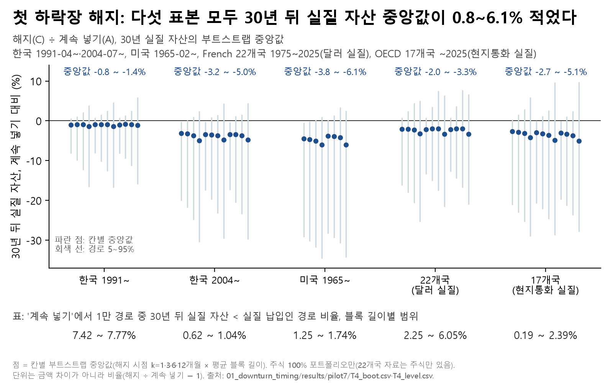
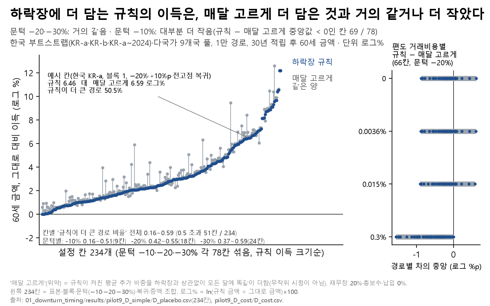

# 01. 첫 하락장 앞의 선택: 해지·중단·더 담기

## 문제의식
연금저축에 매달 돈을 넣다가 처음으로 큰 하락장(고점 대비 −20%)을 만나면 사람들은 흔히 세 가지 중 하나를 합니다. 해지하고 빠져나오거나, 잠깐 넣기를 멈추거나, "쌀 때 더 사자"며 더 넣습니다. 이 선택이 30년 뒤 금액을 얼마나 바꾸는지, 그리고 "하락장에 더 담기"의 이득이 정말 하락장 덕분인지 확인했습니다.

## 한 일
1. **첫 하락장 네 가지 선택 (파일럿 T4)**: 과거 월 수익률을 블록 단위로 다시 뽑아(정상 블록 부트스트랩) 30년(360개월) 적립 경로 10,000개를 만들었습니다. 표본은 한국 1991~·2004~, 미국 1965~, 22개국(달러 실질)·17개국(현지통화 실질) 풀입니다. 첫 약세장에서 A 계속 넣기, B k개월 멈췄다 몰아넣기, C 해지(기타소득세 16.5%) 후 k개월 뒤 새 계좌, D 그해 남은 공제한도를 당겨넣기를 비교했습니다(k = 1·3·6·12개월). D와 같은 돈을 연말에 넣는 대조군 Y를 두어 "하락장 타이밍" 몫(D÷Y)과 "더 넣은 돈" 몫을 갈랐습니다.
2. **하락장 더 담기 규칙 (아이디어 1, D)**: 30세부터 60세까지 TDF식 글라이드패스를 따르는 사람이, 코스피가 고점 대비 −10%·−20%·−30%(문턱)면 주식 비중을 +5·10·15%p 올리고 전고점 회복 또는 1년 뒤 되돌립니다. **위약(placebo)** 은 규칙이 켜진 평균 추가 비중을 하락장과 상관없이 매달 똑같이 더한 것입니다. 한국 부트스트랩 3표본과 다국가 9개국 풀, 234칸(표본·블록·문턱·복귀·증액 조합, 문턱마다 78칸)을 비교했습니다.
3. **거래비용 판본 (D_cost, I1_cost)**: 규칙이 비중을 바꿀 때마다 판 쪽·산 쪽에 편도 비용 0·0.0036%·0.015%·0.1%·0.3%를 뺐습니다.
4. **반대 규칙과 비교 (I1_cost)**: 코스피가 10개월 평균 아래면 주식을 10%p 줄이는 규칙과 더 담기 규칙(+10%p)을 같은 경로에서 비교했습니다.

## 결과

- **해지(C)**: 30년 뒤 실질 자산의 부트스트랩 중앙값이 계속 넣기(A)보다 다섯 표본 모두 적었습니다. 한국 1991~ −0.8~−1.4%, 한국 2004~ −3.2~−5.0%, 미국 1965~ −3.8~−6.1%, 22개국 −2.0~−3.3%, 17개국 −2.7~−5.1%(주식 100%, 해지 시점 k·블록 길이별 범위).
- **멈췄다 몰아넣기(B)**: −0.44~+0.03%로 계속 넣기와 거의 같았습니다.
- **당겨넣기(D)**: +3.3~+5.6%였지만, 같은 돈을 연말에 넣은 대조군(Y)도 +3.2~+5.3%였습니다. 하락장 타이밍 몫(D÷Y)은 0.00~+0.23%입니다. 이득은 대부분 "더 넣어서 세액공제를 받은 것"에서 나옵니다.
- 참고로 계속 넣기(A)에서 시뮬레이션 경로 중 30년 뒤 실질 자산이 실질 납입액보다 적은 경로 비율은 표본·블록별로 0.19~7.77%입니다(한국 1991~ 7.42~7.77%, 한국 2004~ 0.62~1.04%, 미국 1.25~1.74%, 22개국 2.25~6.05%, 17개국 0.19~2.39%).

- **더 담기 규칙 대 위약**: 234칸 전체에서 '규칙이 위약보다 큰 경로 비율'은 0.16~0.59였고, 0.5를 넘은 칸은 51개입니다. 문턱별로는 −10% 0.16~0.51(0.5 초과 9칸/78), −20% 0.42~0.55(18칸/78), −30% 0.37~0.59(24칸/78)입니다. 최솟값 0.16은 −10% 칸에서 나왔고, −10%에서는 78칸 중 69칸에서 규칙 − 위약 경로별 차의 중앙값이 0보다 작았습니다(−20% 60칸, −30% 54칸). 예시 칸(한국 KR-a, 블록 1, −20%·+10%p·전고점 복귀)은 규칙 6.46, 위약 6.59 로그%로, 규칙이 더 큰 경로가 50.5%였습니다.
- **거래비용**(문턱 −20%, 66칸, 규칙 − 위약의 경로별 차 중앙): 비용 0에서 −0.88~+0.62, 0.015%에서 −0.90~+0.58, 0.3%(민감도)에서 −1.56~+0.01 로그%p.
- **더 담기 대 줄이기**: 11칸 모두 더 담기 쪽 60세 금액이 컸습니다(경로별 로그 비의 중앙 +0.54~+11.89 로그%, 비용 0). 비용이 클수록 차이가 커졌습니다(0.3%에서 +2.12~+13.68). 30년 동안 비중을 바꾼 횟수가 줄이기는 경로 평균 46~63번, 더 담기는 8~11번이라 비용이 줄이기 쪽에 더 많이 붙습니다. 두 규칙은 신호와 방향이 함께 달라서, 이 차이를 어느 한쪽 탓으로 나눌 수는 없습니다.

## 말하면 안 되는 것
- "하락장에 더 사면 수익이 난다" — 규칙의 이득은 같은 양을 매달 고르게 더 담은 것(=평소 주식 비중을 조금 높인 것)과 문턱 −20·−30%에서 거의 같았고, −10%에서는 대부분 더 작았습니다.
- "해지하면 ○○원 손해" — 그림 1은 금액이 아니라 비율(해지 ÷ 계속 넣기 − 1)의 중앙값입니다.
- "통계적으로 유의하다" — 칸별 중앙값과 경로 비율을 보고했을 뿐, 칸마다 검정하지 않았고 다중비교 보정도 하지 않았습니다.
- 특정 상품을 사거나 팔라는 뜻이 아닙니다.

## 한계
- 과거 월 수익률을 다시 뽑은 결과입니다. 한국 2004~ 표본은 약 22년이라 서로 다른 큰 하락장이 몇 번 없습니다.
- T4의 세금은 단순화했습니다(공제 16.5%·결정세액 충분 가정, 연 1,500만 원 분리과세 한도 미반영).
- 0.0036%·0.015%는 한 증권사 이벤트 페이지 값(2026-11-06 확인, 이후 재확인 안 함)이고, 0.1%·0.3%는 출처 없는 민감도 값입니다. 펀드 환매 대기 기간은 비용률로만 근사했습니다.
- 위약은 무작위 시점이 아니라 "평균 추가 비중을 매달 고르게" 더한 정적 대조군입니다.
- 결과 파일에는 칸별 요약값만 있고 경로별 값은 없습니다.
- 국내 주식·채권 수익률이 DataGuide 자료라 원자료 없이는 다시 돌릴 수 없습니다(`../DATA_SOURCES.md`).

## 파일
- `figures/`: 그림 1·2(`.png`·`.svg`), 그림에 쓴 숫자(`_data.csv`), 읽은 결과 파일의 sha256(`_source.txt`).
- `results/`: 위 숫자의 출처. `pilot7/T4_boot.csv`·`T4_level.csv`, `pilot9_D_simple/D_placebo.csv`, `pilot9_D_cost/D_cost.csv`(+결과 문서), `pilot10_I1_cost/I1_cost*.csv`(+결과 문서). 모두 1만 경로를 요약한 표입니다.
- 코드(`notebooks/`, 공통 모듈은 `../src/pension_lab/`):
  - `pilot7/T4_첫하락장네선택.py` — T4 (`pilot7`·`bootstrap`·`aftertax` 사용)
  - `pilot9/_gen_D_simple.py` → `D_simple_20261017.ipynb` 생성·실행(결과 출력은 지움). `_build_C_real_inputs.py`의 글라이드·보수 함수를 씀
  - `pilot9/_run_D_cost_20261106.py` — D 노트북 셀을 그대로 실행한 뒤 비용을 넣음
  - `pilot10/_gen_I1_simple.py` → `I1_simple_20261017.ipynb`, `pilot10/_run_I1_cost_20261106.py`
  - `portfolio/make_figures.py` — 그림 1·2·3(그림 3은 `../02_tdf_vs_diy/`)

---
**English summary.** Using 10,000 bootstrapped 30-year saving paths for Korea, the US and two multi-country pools, canceling a pension account at the first bear market left median real wealth 0.8–6.1% lower than continuing, while pausing changed almost nothing. A "buy more after a drop" rule (drop thresholds −10%, −20%, −30%; 78 settings each, 234 in all) gained about as much as a placebo that adds the same average extra equity every month at −20% and −30%, and mostly less at −10% (share of paths where the rule won: 0.16–0.59 overall; 0.16–0.51 at −10%, 0.42–0.55 at −20%, 0.37–0.59 at −30%). The share of simulated paths ending below real contributions when continuing was 0.19–7.77%. Results are medians from historical resampling, not tests of significance and not investment advice.
