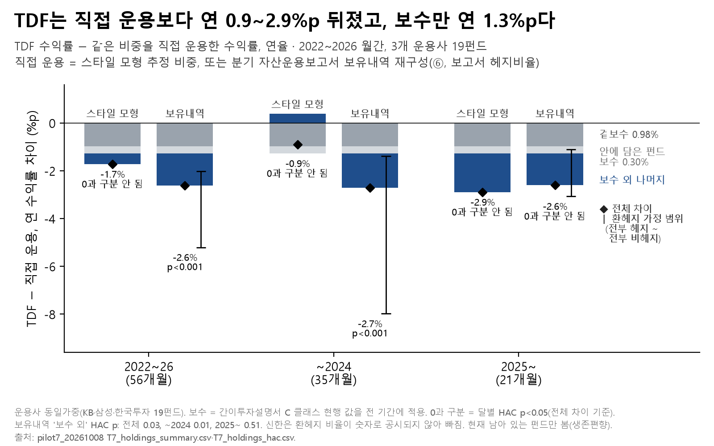

# 02. TDF 대 직접 운용

## 문제의식
TDF(타깃데이트펀드)는 은퇴 시점에 맞춰 주식·채권 비중을 알아서 바꿔 줍니다. 편하지만 보수가 붙습니다. 같은 비중을 ETF로 직접 맞추면 수익률이 얼마나 다를지, 그 차이가 보수 때문인지 다른 이유 때문인지 나눠 봤습니다.

선행연구와의 관계: 미국 TDF의 성과 열위를 다룬 Brown & Davies, "Off Target: On the Underperformance of Target-Date Funds"(SSRN 3707755, 2020-11 게시·2023-10 개정, 미게재 원고)와 같은 질문을 한국 TDF에 던진 작업입니다. 그 논문 초록에는 연 수치가 없고(2019년 초과비용 86억 달러), 저자 인터뷰(Rational Reminder 374회)에서는 복제 포트폴리오 대비 연 약 1%, 그중 약 55bp가 보수라고 했습니다. 흔히 인용되는 '연 1.28%·약 3분의 2가 보수'는 원문으로 확인하지 못했습니다. 본문 수치와는 직접 비교하지 않았습니다.

## 한 일
- 대상: KB·삼성·한국투자 TDF 19개, 2022~2026 월간(56개월). 운용사별로 같은 가중치를 줘 평균했습니다(운용사 동일가중).
- 직접 운용을 두 가지로 만들었습니다.
  1. **스타일 모형**: TDF 수익률을 국내·해외 주식, 국내·해외 채권, 금 같은 자산군 지수·ETF 수익률로 설명하는 제약 회귀(비중 ≥ 0, 합 = 1; Sharpe 1992)로 비중을 추정하고, 그 비중을 직접 들고 간 수익률.
  2. **보유내역 재구성(⑥)**: 분기 자산운용보고서에 공시된 보유 종목을 자산군으로 묶고, 보고서의 환헤지 비율을 써서 다시 만든 수익률.
- 직접 운용 쪽은 ETF 보수가 빠진 가격, 국고채 지수에 연 0.17% 보수, 매매비용 0.0042%를 반영했습니다.
- TDF 보수는 간이투자설명서 C 클래스 현행 값(겉보수 + 안에 담은 펀드의 보수)을 전 기간에 적용해, 차이를 '보수'와 '보수 외 나머지'로 나눴습니다. 0과 다른지는 달별 차이의 HAC t검정으로 봤습니다.

## 결과

| 기간 | 스타일 모형: TDF − 직접 | 보유내역: TDF − 직접 | 보유내역: 보수 외 나머지 |
|---|---|---|---|
| 2022~26 (56개월) | −1.73%p (p 0.16) | −2.61%p (p<0.001) | −1.33%p (p 0.034) |
| ~2024 (35개월) | −0.90%p (p 0.25) | −2.71%p (p<0.001) | −1.43%p (p 0.011) |
| 2025~ (21개월) | −2.90%p (p 0.45) | −2.60%p (p 0.195) | −1.33%p (p 0.51) |

- 비교 6개(기간 3 × 직접 운용 방식 2)의 점추정은 −0.90~−2.90%p이고, 그중 0과 구분되는 것(HAC p<0.05)은 보유내역 2022~26·~2024 두 개뿐입니다. 점추정의 운용사 동일가중 평균과 p값의 HAC 평균차는 계산 방식이 달라 숫자가 조금 다를 수 있습니다.
- 보수는 연 1.28%p입니다(겉보수 0.98% + 안에 담은 펀드 보수 0.30%). 차이의 하한(0.90%p)이 보수보다 작아, 모든 비교에서 "차이 중 보수가 1.28%p"라고 나눌 수는 없습니다.
- 보수 외 나머지는 환헤지를 어떻게 가정하느냐에 크게 흔들립니다. 2022~26 보유내역 차이는 전부 헤지로 보면 −2.02%p, 전부 비헤지로 보면 −5.21%p입니다.
- 운용사별 보수 외 나머지(2022~26)는 KB −2.16%p, 삼성 −2.09%p, 한국투자 +0.26%p로 엇갈렸습니다.

## 말하면 안 되는 것
- "TDF를 사지 마라" — 직접 운용에 드는 시간·실수·리밸런싱 습관은 계산에 넣지 않았습니다.
- "운용 실력이 나빠서 뒤졌다" — 보수 외 나머지에는 하위 펀드 성과, 환헤지 비용과 시점, 모형 오차가 섞여 있고, 헤지 가정과 운용사에 따라 부호까지 바뀝니다.
- "2025년 이후에도 뒤진다는 것이 확인됐다" — 21개월이라 0과 구분되지 않습니다.

## 한계
- 지금 남아 있는 펀드만 봤습니다(생존편향). 신한은 환헤지 비율이 숫자로 공시되지 않아 빠졌습니다.
- 보수는 현행 값을 과거 전체에 적용했습니다.
- 기간이 56개월로 짧고, 운용사가 셋뿐입니다.
- 국내 주식·채권 지수가 DataGuide 자료라 원자료 없이는 다시 돌릴 수 없습니다. TDF 기준가·보수·보유내역(금융투자협회·운용사 공시)은 재배포 조건을 확인하지 못해 넣지 않고, 받는 코드만 넣었습니다(`../DATA_SOURCES.md`).

## 파일
- `figures/`: 그림 3(`.png`·`.svg`), 그림 숫자(`_data.csv`), 읽은 결과 파일 sha256(`_source.txt`). 그림 스크립트는 `../01_downturn_timing/notebooks/portfolio/make_figures.py`.
- `results/pilot7/`: `T7_holdings_summary.csv`(기간·비교별 운용사 동일가중 차이와 보수), `T7_holdings_hac.csv`(HAC 검정), `T7_holdings_by_manager.csv`(운용사별). 모두 요약 표입니다.
- 코드: `notebooks/pilot7/T7_TDF_vs_직접.py` (공통 모듈 `pilot7`·`tdf_style`·`glidepath`·`perfstats`·`bootstrap`). 공시 자료를 받는 코드는 `../src/pension_lab/fetch/`(`kofia_tdf.py` 기준가, `tdf_fee_extract.py`·`tdfext_fee_extract.py` 보수, `mgmt_report_tdf.py` 자산운용보고서).

---
**English summary.** Across six comparisons (three periods × two replication methods), nineteen Korean target-date funds from three managers had point estimates 0.9–2.9 percentage points a year below a do-it-yourself replica of the same allocation over 2022–2026; only two of the six are distinguishable from zero (HAC p<0.05). Explicit fees are 1.28 pp a year. The non-fee remainder (about −1.3 to −1.4 pp with the reported hedge ratios) swings widely with the currency-hedging assumption and across managers. This mirrors the question of Brown & Davies' "Off Target" for the US, but their numbers were not compared directly: the abstract gives no annual figure (US$8.6 billion of excess costs in 2019); in an interview (Rational Reminder episode 374) the authors put the gap at about 1% a year against a replicating portfolio, about 55 bp of it fees. The often-quoted '1.28% a year, about two-thirds fees' could not be verified against the paper.
