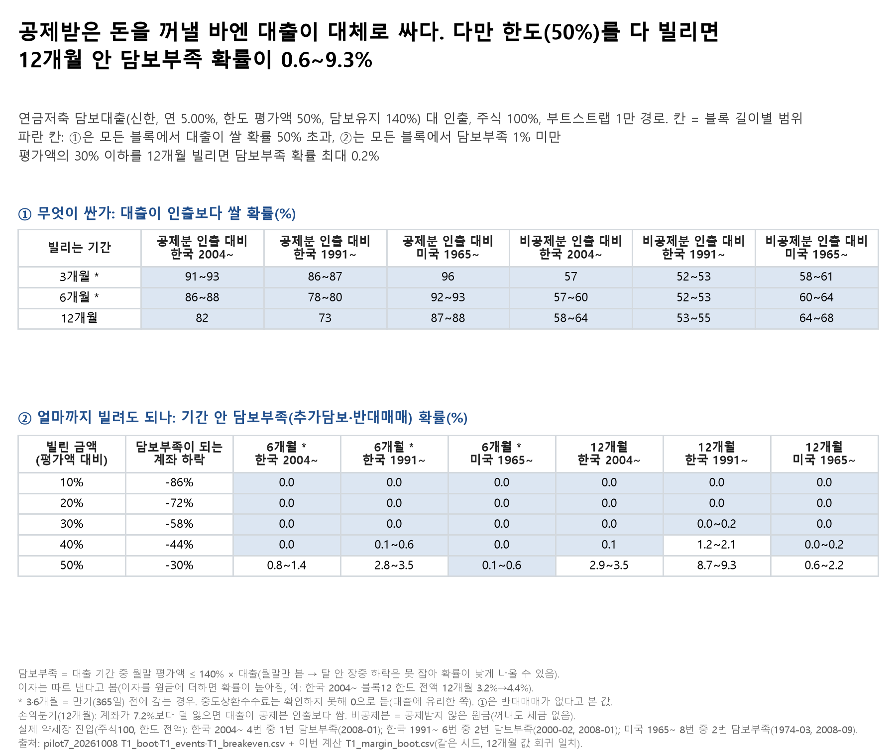

# 04. 해지 대신 대출 — 급전이 필요할 때 연금저축을 깨지 말고 빌릴까

## 문제의식

연금저축에서 세액공제를 받은 돈을 꺼내면 16.5% 세금이 붙습니다. 그런데 계좌를 담보로 연 5.00%에 빌리는 상품도 있습니다(신한투자증권, 한도 평가액의 50%·최대 4,000만 원, 담보유지비율 140%, 기간 365일).
대출은 세금이 없는 대신 이자가 나가고, 계좌가 많이 떨어지면 담보가 모자라 추가 담보를 넣거나 강제로 팔리는(반대매매) 위험이 있습니다.

## 한 일

- 파일럿 T1(10월 8일)의 부트스트랩을 그대로 다시 돌렸습니다(같은 시드 20261008, 경로 10,000개, 한국 2004~·1991~, 미국 1965~). 12개월 결과가 기존 파일과 소수 12자리까지 같은지 확인했습니다.
- 새로 센 것은 두 가지입니다. ① 빌린 금액(평가액의 10~50%)마다, 기간 안 어느 월말에 평가액이 대출의 140% 아래로 내려간 경로의 비율(담보부족 확률). ② 3·6개월에 갚는 경우의 비용 비교.
- 결과: `T1_margin_boot.csv`(표본·포트폴리오·블록·기간·금액 전부), 그림 `fig_T1_대출_금액기간표`.

## 결과

- **공제받은 돈을 꺼내야 한다면 대출이 대체로 싸다.** 12개월, 주식 100% 기준 대출이 공제분 인출보다 쌀 확률: 한국 2004~ 82%, 한국 1991~ 73%, 미국 87~88%. 계좌가 12개월 동안 7.2%보다 덜 잃으면 대출이 쌉니다.
- **공제받지 않은 원금을 꺼낼 수 있다면 반반에 가깝다.** 같은 조건에서 대출이 쌀 확률 53~68%.
- **한도를 다 빌리면(평가액 50%) 12개월 안 담보부족 확률**: 한국 2004~ 2.9~3.5%, 한국 1991~ 8.7~9.3%, 미국 0.6~2.2%. 계좌가 30% 떨어지면 걸립니다.
- **평가액의 30% 이하만 빌리면** 12개월 담보부족 확률이 모든 표본·블록에서 0.2% 이하였습니다(계좌가 58% 넘게 떨어져야 걸림).
- 실제 약세장 진입 때 한도를 다 빌렸다면(주식 100%): 한국 2004~ 4번 중 1번 담보부족(2008-01); 한국 1991~ 6번 중 2번 담보부족(2000-02, 2008-01); 미국 1965~ 8번 중 2번 담보부족(1974-03, 2008-09).

## 말하면 안 되는 것

- "연금저축 담보대출은 안전하다" — 한도를 다 빌리면 2008년 같은 하락에서 담보부족이 실제로 났을 것입니다.
- "대출이 항상 싸다" — 공제받지 않은 원금을 꺼낼 수 있으면 반반이고, 계좌가 크게 떨어진 해에는 인출이 더 쌌습니다.
- 확률을 "앞으로 일어날 확률"로 말하기 — 과거 수익률을 다시 뽑은 값입니다.

## 한계

- 월말 값만 봐서 달 중간 장중 하락은 못 잡습니다(담보부족 확률이 낮게 나올 수 있음). 이자는 따로 낸다고 봤습니다. 이자를 원금에 더하면 담보부족 확률이 높아집니다(예: 한국 2004~ 주식100 블록12 한도 전액 12개월 3.2%→4.4%, `T1_margin_interest.csv`).
- 3·6개월 칸은 만기 전에 갚는 경우입니다. 중도상환수수료를 확인하지 못해 0으로 뒀습니다(대출에 유리한 쪽, ⬜ 확인 필요). 신한 상품 페이지 원문 스냅샷은 이번에 다시 받지 못했고, 조건은 파일럿 근거 대장(10월 8일, 1차 출처 https://www.shinhansec.com/siw/pension/saving-info/saving_account_service1/view.do, 2026.01.01 기준)의 값입니다. 한도 상한 4,000만 원은 평가액이 8,000만 원을 넘을 때만 걸리고, 표는 평가액 대비 비율이라 영향이 없습니다.
- 대출이 쌀 확률은 반대매매가 없다고 본 값입니다. 반대매매가 나면 그때 판 금액에 세금이 붙어 대출 쪽 비용이 더 커집니다(`P(대출<② 이고 담보부족 없음)` 열 참고).
- 파일럿 T1의 다른 대출 2종과 '그때 금리' 방식은 이번 표에서 뺐습니다(연 5.00% 신한 조건만). 문서의 "0.67~0.96" 범위는 이들을 모두 합친 값입니다.
- 실제 약세장 진입 사건은 파일럿 T1 정의(직전 고점을 회복한 뒤에만 새 사건으로 셈)를 따라, 한국 1997년 외환위기 하락은 따로 세지 않았습니다.
- 2026년 세법·금리를 과거 수익률에 얹은 반사실이고, 미국 표본은 한국 세제를 미국 수익률에 얹은 것입니다.

## 그림

## 파일

- `figures/`: 그림(`.png`·`.svg`), 그림 숫자(`_data.csv`), 읽은 결과 파일 sha256(`_source.txt`).
- `results/portfolio/`: `T1_margin_boot.csv`(표본·기간·포트폴리오·블록·빌리는 기간·금액별 담보부족 확률과 대출이 쌀 확률, 1만 경로 비율), `T1_margin_interest.csv`(이자를 원금에 더한 예시 1칸).
- `results/pilot7/`: 파일럿 T1 결과 — `T1_boot.csv`(대출 3종·금리 2방식의 '대출이 쌀 확률'), `T1_events.csv`(실제 약세장 진입 사건별 12개월 수익·최저), `T1_breakeven.csv`(손익분기 수익률). 모두 요약 표입니다.
- 코드: `notebooks/portfolio/make_topics_a.py`(04~07 공용, 그림·README), `notebooks/pilot7/T1_해지대신꺼내기.py`(파일럿 T1, 공통 모듈 `pilot7`·`bootstrap`).
- 실행: 저장소 루트에서 `python 04_loan_vs_withdraw/notebooks/portfolio/make_topics_a.py t1` — 원자료가 없으면 저장된 `results/portfolio/` CSV로 그림·README만, `PENSION_DATA_ROOT`가 있으면 부트스트랩부터 다시 돌리고 12개월 값이 `results/pilot7/T1_boot.csv`와 같은지 확인. 파일럿 원 계산(`notebooks/` 아래)은 DataGuide 원자료가 필요합니다(루트 README '재현 방법' 3, `../DATA_SOURCES.md`).

본문의 '파일럿 T1·T3·T5·T6·T2', '10월 19일 A' 같은 이름은 원 연구 저장소의 분석 이름이고, 그 결과 파일은 이 폴더 `results/`에 있습니다. '문서'·'포트폴리오 문서'는 원 연구 저장소의 요약 문서(이 저장소에 없음), '9번 주제'는 원 연구 저장소의 다른 주제입니다.

---
**English summary.** Should a Korean pension-savings holder who needs cash borrow against the account instead of withdrawing? Using a block bootstrap of past monthly returns (Korea 2004–, 1991–; US 1965–) with 2026 tax rules and one broker's loan terms, borrowing for 12 months was usually cheaper than withdrawing tax-deducted money, but close to a coin flip against withdrawing non-deducted principal. Borrowing the full 50% limit carried a margin-shortfall (top-up or forced sale) probability of up to about 9% over 12 months depending on the sample; borrowing 30% or less kept it at 0.2% or below. Figures are resampled history, not forecasts. Not investment advice.

_생성: 04_loan_vs_withdraw/notebooks/portfolio/make_topics_a.py (본문 숫자는 결과 CSV에서 읽어 자동으로 채움. English summary는 고정 문장이고, 그 숫자는 `check_numbers.py`가 결과 CSV와 대조)_
