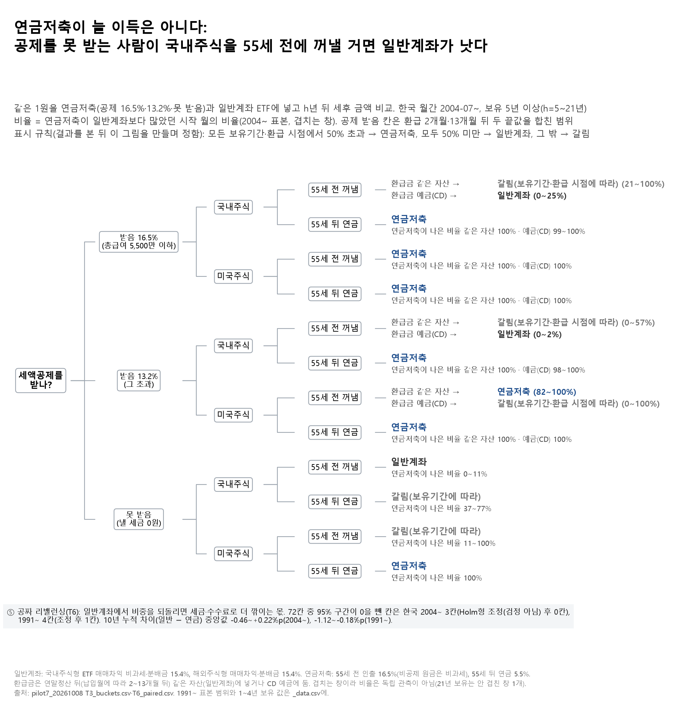

# 05. 두 통 설계 + 공짜 리밸런싱 — 연금저축이 누구에게나 이득일까

## 문제의식

"연금저축은 무조건 이득"이라는 말은 세액공제를 받는 사람 기준입니다. 낼 세금이 0원이라 공제를 못 받는 사회초년생, 그리고 국내주식 ETF(일반계좌에서도 매매차익 비과세)를 담는 사람에게는 답이 다를 수 있습니다.
또 "연금계좌에서는 리밸런싱(비중 되돌리기)에 세금이 없다"는 장점이 실제로 얼마나 큰지도 함께 봤습니다.

## 한 일

- 같은 1원을 ① 공제받는 연금저축(공제율 16.5%·13.2% 두 단계) ② 공제 못 받는 연금저축 ③ 일반계좌 ETF에 넣고, 국내주식·미국주식 각각, 55세 전에 꺼내는 경우와 55세 뒤 연금으로 받는 경우의 세후 금액을 비교했습니다(파일럿 T3, 한국 월간 2004-07~·1991-04~, 보유 1~30년의 모든 시작 월). 공제 환급금은 납입월에 따라 2~13개월 뒤 들어오므로 두 끝값(2개월·13개월)을 합쳐 범위로 보였습니다.
- 결정 나무의 표시는 파일럿 결과를 본 뒤 이 그림을 만들면서 정한 규칙입니다(사전에 등록한 규칙 아님): 2004~ 표본에서 보유 5년 이상의 모든 보유기간·두 환급 시점에서 연금저축이 나은 시작 월이 50%를 넘으면 "연금저축", 모두 50% 미만이면 "일반계좌", 그 밖은 "갈림".
- 5번(T6): 72가지 조건(포트폴리오 2 × 기간 3 × 수수료 2 × 리밸런싱 방식 6)에서 일반계좌가 연금계좌보다 리밸런싱으로 더 깎이는 몫을 부트스트랩으로 쟀습니다.

## 결과

- **공제를 못 받는 사람이 국내주식을 55세 전에 꺼낼 거면 일반계좌가 낫다.** 5년 이상 보유에서 연금저축이 나은 시작 월은 0~11%(= 일반계좌가 나은 비율 89~100%). 1~4년 보유에서도 연금저축이 나은 비율 13~38%.
- **미국주식을 55세 뒤 연금으로 받으면 공제 여부·공제율과 상관없이 연금저축이 낫다**(5년 이상 보유의 모든 시작 월, 연금소득세 5.5% 대 일반계좌 15.4%). 공제를 받는 사람의 국내주식 55세 뒤 연금도 연금저축이 나은 비율 98% 이상이었습니다.
- **공제를 받는 사람이 국내주식을 55세 전에 꺼내면 환급금을 어디 두느냐가 중요하다.** 5년 이상 보유에서 연금저축이 나은 비율(환급 2~13개월): 환급금을 예금(CD)에 두면 공제율 16.5%에서 0~25%, 13.2%에서 0~2%로 일반계좌가 나았고, 같은 자산에 다시 넣으면 16.5%에서 21~100%, 13.2%에서 0~57%로 갈렸습니다.
  - 참고(문서의 45~100%·0~46%와 같은 조건): 공제율 16.5%·환급 2개월·보유 1년 이상·두 표본이면 같은 자산 45~100%, CD 0~46%. 환급이 13개월 뒤면 같은 자산 쪽 비율이 크게 낮아집니다(2004~·보유 5년 이상: 환급 2개월 73~100% → 13개월 21~61%).
- 공제율 13.2%인 사람의 미국주식 55세 전 인출은 환급금을 같은 자산에 넣으면 82~100%(연금저축), 예금에 두면 0~100%(갈림)이었습니다.
- 공제 못 받는 사람의 국내주식 55세 뒤 연금(37~77%), 미국주식 55세 전(11~100%)은 보유기간에 따라 갈렸습니다.
- **공짜 리밸런싱의 이득은 작다.** 72칸 중 95% 구간이 0을 뺀 칸은 2004~ 3칸(원 결과의 'Holm형 조정(검정 아님)' 열 기준 0칸), 1991~ 4칸(조정 후 1칸). 10년 누적 차이 중앙값 -0.46~+0.22%p(2004~), -1.12~-0.18%p(1991~).

## 말하면 안 되는 것

- "연금저축은 무조건 이득이다" / "연금저축은 손해다" — 공제 여부·자산·꺼내는 시점에 따라 갈립니다.
- 비율을 "확률"로 말하기 — 겹치는 시작 월의 비율이라 독립 관측이 아니고, 21년 보유는 안 겹친 창이 1개뿐입니다.
- "리밸런싱 이득이 없다" — 작다는 것이지 0이라는 증거는 아닙니다.

## 한계

- 공제율 16.5%와 55세 전 인출세 16.5%가 같아서, 공제받는 사람의 결론은 환급금을 어떻게 쓰느냐에 크게 좌우됩니다(기준 시나리오는 정하지 않고 둘 다 보임).
- 미국주식 분배금은 S&P500 지수 배당으로 근사했고, 연금 수령한도·1,500만 원 분리과세 한도·세법 개정은 넣지 않았습니다.
- 한국 표본이 짧고 2025~26년 급등의 비중이 큽니다. 1991~ 표본 범위는 `fig_T3T6_결정나무_data.csv`에 같이 실었습니다.
- 국내 선행연구로는 정요섭(2006), 「개인연금에 대한 소득공제의 수익률효과 분석」, 『보험개발연구』 17(2), 41–60쪽과 정요섭(2016), 「연금저축의 세액공제 초과불입금에 대한 세제지원 효과 분석」, 『보험학회지』 107, 167–196쪽(수리모형, 초과불입금 = 공제를 못 받은 납입) 두 편의 서지를 확인했습니다.

## 그림

## 파일

- `figures/`: 그림(`.png`·`.svg`), 그림 숫자(`_data.csv`: 잎·환급금 사용법별 2004~·1991~ 범위, 1~4년 보유 값), 읽은 결과 파일 sha256(`_source.txt`).
- `results/pilot7/`: `T3_buckets.csv`(표본·보유기간·자산·인출 시점·계좌·환급 지연별 '연금저축이 일반계좌보다 나은 시작 월 비율'과 세후배수 중앙값), `T6_paired.csv`(리밸런싱 비용 차이의 부트스트랩 중앙값·95% 구간). 모두 요약 표입니다.
- 코드: `../04_loan_vs_withdraw/notebooks/portfolio/make_topics_a.py`(그림·README), `notebooks/pilot7/T3_두통설계.py`·`T6_공짜리밸런싱.py`(파일럿 원 계산, 공통 모듈 `pilot7`·`bootstrap`).
- 실행: 저장소 루트에서 `python 04_loan_vs_withdraw/notebooks/portfolio/make_topics_a.py t3t6` — 저장소 `results/`만 읽어 원자료 없이 됩니다. 파일럿 원 계산(`notebooks/` 아래)은 DataGuide 원자료가 필요합니다(루트 README '재현 방법' 3, `../DATA_SOURCES.md`).

본문의 '파일럿 T1·T3·T5·T6·T2', '10월 19일 A' 같은 이름은 원 연구 저장소의 분석 이름이고, 그 결과 파일은 이 폴더 `results/`에 있습니다. '문서'·'포트폴리오 문서'는 원 연구 저장소의 요약 문서(이 저장소에 없음), '9번 주제'는 원 연구 저장소의 다른 주제입니다.

---
**English summary.** Is a Korean pension savings account always better than a taxable brokerage account? Comparing after-tax outcomes of the same contribution for every historical start month (Korea, 2004– and 1991–), the answer depends on whether the saver gets the tax credit, the asset (Korean equity ETFs are tax-free on gains outside the account), when the money comes out (before 55 vs. as a pension), and what is done with the tax refund. Savers without a credit who withdraw Korean equity before 55 did better in the taxable account; US equity taken as a pension favoured the pension account for every group. The benefit of tax-free rebalancing inside the account was small. The display rule of the decision tree was set after seeing pilot results. Not investment advice.

_생성: 04_loan_vs_withdraw/notebooks/portfolio/make_topics_a.py (본문 숫자는 결과 CSV에서 읽어 자동으로 채움. English summary는 고정 문장이고, 그 숫자는 `check_numbers.py`가 결과 CSV와 대조)_
