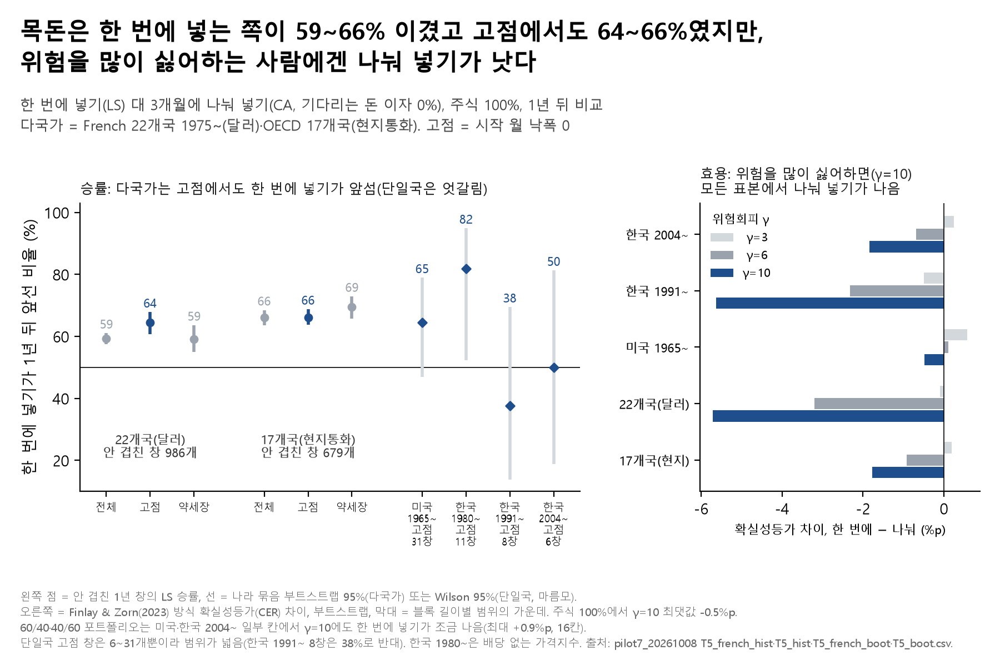

# 06. 목돈 한 번에 vs 나눠 넣기 — 보험에서 옮긴 목돈, 고점이면 나눠 넣어야 할까

## 문제의식

보험·신탁에서 연금저축펀드로 목돈을 옮기는 사람이 많습니다(보도: 2024년~2026년 1분기 누적 9조 2,585억 원, 2차 출처, 의원실 원문 미확인). 옮긴 날이 마침 주가 고점이면 "몇 달에 나눠 넣는 게 안전하다"는 말을 흔히 듣습니다. 평균으로 이기는 쪽과 그 사람에게 나은 쪽이 같은지 따져 봤습니다.

## 한 일

- 한 번에 넣기(LS)와 3개월에 나눠 넣기(CA)의 1년 뒤 금액을 비교했습니다(파일럿 T5). 기다리는 돈의 이자는 0%와 단기금리 두 가지.
- 자료: 한국 2004~·1991~·1980~(코스피 가격), 미국 1965~, French 22개국 1975~(달러), OECD 17개국(현지통화). 시작 월이 고점(낙폭 0)·약세장(낙폭 −20% 이하)인 경우를 따로 셌습니다.
- 승률 외에 위험을 싫어하는 정도(γ=3·6·10)를 반영한 확실성등가(CER) 차이를 Finlay & Zorn(2023) 방식으로 계산했습니다.
- 차별점(국내 선행연구 박영규·이상엽 2010 등 대비): 고점 시작 + 다국가 + 효용. 선행연구 목록은 파일럿 문서 기준이며 이번에 다시 대조하지 않았습니다.

## 결과

- **평균으로는 한 번에 넣기가 이긴다.** 안 겹친 1년 창 승률: 22개국 59%, 17개국 66%(주식 100%, 3개월 분할, 이자 0%).
- **다국가 자료에서는 고점에서 시작해도 마찬가지였다.** 22개국 64%, 17개국 66%.
- **단일국 고점 창은 엇갈렸다:** 미국 65%(31창, Wilson 47~79%), 한국 1980~ 82%(11창, Wilson 52~95%), 한국 1991~ 38%(8창, Wilson 14~69%), 한국 2004~ 50%(6창, Wilson 19~81%) — 창이 적어 범위가 넓습니다.
- **위험을 많이 싫어하는 사람(γ=10)에게는 모든 표본에서 나눠 넣기가 나았다**(주식 100%). CER 차이(한 번에 − 나눠): 한국 2004~ -1.8%p, 한국 1991~ -5.6%p, 미국 -0.5%p, 22개국 -5.7%p, 17개국 -1.9~-1.7%p.
- γ=3이면 표본에 따라 한 번에 넣기가 조금 낫거나 비슷했습니다(최댓값 +0.6%p).

## 말하면 안 되는 것

- "고점이면 나눠 넣어라" — 다국가 고점 창에서도 한 번에 넣기가 약 3분의 2를 이겼습니다.
- "한 번에 넣는 게 정답" — 위험을 많이 싫어하는 사람에게는 나눠 넣기가 더 나았습니다.
- "모든 포트폴리오에서 γ=10이면 나눠 넣기" — 60/40·40/60에서는 미국·한국 2004~ 일부 칸(16칸)에서 반대였습니다(최대 +0.9%p).

## 한계

- 단일국 고점 창은 6~31개뿐이라 단일국 결과로는 판단하기 어렵습니다(한국 1991~ 8창은 38%로 반대). 이 값은 가격지수 기준이고, 원 결과의 '총수익(민감도)'으로 보면 한국 2004~ 86%(7창), 한국 1991~ 73%(11창), 미국 1965~ 74%(39창)로 달라집니다.
- 한국 1980~은 배당이 없는 가격지수라 주식 수익이 낮게 잡힙니다. 22개국은 달러 기준이라 원화 투자자와 다릅니다.
- 3개월 분할 외 4~6개월, 기다리는 돈에 단기금리를 준 결과는 원 결과 파일(pilot7 `T5_*.csv`)에 있습니다(이자를 주면 승률이 조금 낮아짐). 60/40·40/60의 반대 칸 수에는 한국 2004~의 2024년까지 부분 표본도 들어 있습니다.
- 보험·신탁에서 펀드로 옮긴 공식 통계는 찾지 못했습니다.

## 그림

## 파일

- `figures/`: 그림(`.png`·`.svg`), 그림 숫자(`_data.csv`), 읽은 결과 파일 sha256(`_source.txt`).
- `results/pilot7/`: `T5_french_hist.csv`·`T5_hist.csv`(과거 창 승률·Wilson·나라 묶음 부트스트랩 구간), `T5_french_boot.csv`·`T5_boot.csv`(부트스트랩 승률·확실성등가 차이). 모두 요약 표입니다.
- 코드: `../04_loan_vs_withdraw/notebooks/portfolio/make_topics_a.py`(그림·README), `notebooks/pilot7/T5_이전후진입.py`(파일럿 원 계산, 공통 모듈 `pilot7`·`bootstrap`).
- 실행: 저장소 루트에서 `python 04_loan_vs_withdraw/notebooks/portfolio/make_topics_a.py t5` — 저장소 `results/`만 읽어 원자료 없이 됩니다. 파일럿 원 계산(`notebooks/` 아래)은 DataGuide 원자료가 필요합니다(루트 README '재현 방법' 3, `../DATA_SOURCES.md`).

본문의 '파일럿 T1·T3·T5·T6·T2', '10월 19일 A' 같은 이름은 원 연구 저장소의 분석 이름이고, 그 결과 파일은 이 폴더 `results/`에 있습니다. '문서'·'포트폴리오 문서'는 원 연구 저장소의 요약 문서(이 저장소에 없음), '9번 주제'는 원 연구 저장소의 다른 주제입니다.

---
**English summary.** When a lump sum moves into a pension fund, should it go in at once or over three months? In non-overlapping one-year windows across 22 (USD) and 17 (local-currency) countries, investing at once won 59–66% of the time, and 64–66% in windows that started at a market peak; single-country peak windows were few and mixed. For a highly risk-averse investor (relative risk aversion 10), spreading the money had a higher certainty-equivalent return in every sample for an all-equity portfolio, but not for every balanced-portfolio cell. Not investment advice.

_생성: 04_loan_vs_withdraw/notebooks/portfolio/make_topics_a.py (숫자는 결과 CSV에서 읽어 자동으로 채움)_
