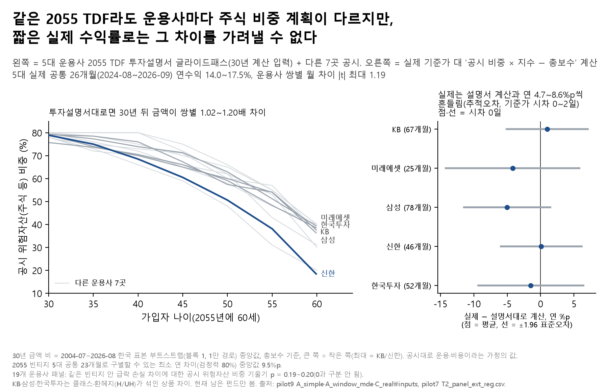

# 07. 운용사별 2055 TDF — 짧은 수익률 순위로 TDF를 고르면 안 되는 이유

## 문제의식

이름이 같은 "TDF 2055"라도 운용사마다 나이에 따라 주식을 줄여 가는 계획(글라이드패스)이 다릅니다. 가입자는 보통 최근 1~2년 수익률 순위를 보고 고릅니다. 그 순위가 운용사 차이를 말해 주는지 따져 봤습니다.

## 한 일

- 5대 운용사(KB·미래에셋·삼성·신한·한국투자) 2055 TDF의 투자설명서 글라이드패스를 그대로 따랐다고 보고, 2004-07~2026-08 한국 자료를 다시 뽑은 같은 시장 경로 1만 개에서 30년 적립 금액을 비교했습니다(10월 19일 A).
- 실제 기준가와 '공시 비중 × 지수 − 총보수' 계산을 겹치는 달끼리 대조해, 실제가 설명서 가정에서 얼마나 벗어나는지 쟀습니다.
- 운용사를 19곳으로 늘린 패널(파일럿 T2)로, 같은 빈티지 안 급락 손실 차이가 공시 위험자산 비중으로 설명되는지 회귀로 봤습니다(운용사 군집 표준오차·wild cluster bootstrap).
- 그림: `fig_T2A_운용사별_글라이드`(왼쪽 공시 경로, 오른쪽 실제 − 계산).

## 결과

- **설명서대로라면 운용사 사이 30년 금액이 1.02~1.20배 차이**(블록 1, 총보수, 중앙값, 큰 쪽 ÷ 작은 쪽). 가장 큰 쌍은 KB/신한으로, 신한의 60세 위험자산 비중이 18%로 다른 네 곳(36~39%)보다 낮습니다.
- **그러나 실제 수익률은 설명서 계산과 연 4.7~8.6%p씩 흔들렸다**(추적오차, 실제 기준가를 계산과 0·1·2 영업일 어긋나게 맞춘 세 경우 전체, 운용사별 25~79개월). 평균 차는 운용사별 -5.03~+0.99%p/년이었고 |t| ≤ 1.85로 0과 구분되지 않았습니다. 추적오차는 시차 0일일 때 가장 커서(6.2~8.6%p) 일부는 기준가 날짜 어긋남 때문일 수 있습니다.
- **실제 기록이 짧아 순위를 가려낼 수 없다.** 5대 공통 26개월 연수익은 14.0~17.5%였지만 운용사 쌍별 |t| 최대 1.19. 2055 빈티지 5대 공통 23개월로 구별할 수 있는 최소 연 차이(검정력 80%)는 중앙값 9.5%p, 기록이 긴 2030~2045 빈티지(공통 86개월)도 3.7~4.4%p입니다.
- **19개 운용사로 늘려도** 같은 빈티지 안 급락 손실 차이는 공시 위험자산 비중으로 설명되지 않았습니다(기울기 -0.150~-0.095, p = 0.19~0.20, WCB p = 0.17~0.18).
- 그래서 "짧은 수익률 순위로 고르면 안 되는 이유": 실제 수익률은 설명서 계산에서 해마다 연 4.7~8.6%p씩 흔들리고, 2055 빈티지의 2년 남짓한 공통 기록으로는 연 약 9.5%p보다 작은 진짜 차이를 안정적으로 구별하기 어렵습니다. 그래서 최근 순위는 운용사 차이보다 우연을 더 많이 담고 있을 수 있습니다.

## 말하면 안 되는 것

- "어느 운용사가 더 잘한다" / "신한 TDF가 30년 뒤 20% 덜 번다" — 30년 비는 설명서대로 운용하고 비용이 설명서대로라는 가정의 값이고, 실제 운용사 차이의 크기·순서를 말해 주지 않습니다.
- "운용사 차이가 없다" — 차이가 없다는 증거가 아니라, 이 기록으로는 가려낼 수 없다는 뜻입니다.

## 한계

- KB·삼성·한국투자 실제 기준가는 클래스·환헤지(H/UH) 판이 섞여 있어 "운용사 차이"가 아니라 "클래스·헤지를 포함한 상품 차이"입니다.
- 30년 동안 현행 공시 글라이드를 그대로 따른다고 가정했습니다(실제로는 글라이드가 바뀐 적이 있음 — 9번 주제).
- 현재 남아 있는 펀드만 봤습니다(생존편향). 국내 선행연구(홍원구 2026, 최재윤·박영규 2025)가 있어 "새 발견"이 아니라 "자료를 넓혀 다시 확인한 분석"입니다(선행연구 목록은 포트폴리오 문서 기준, 이번에 원문 재대조 안 함).
- 실제 수익률 비교(원 A, 2024-08~2026-09 26개월)와 구별 가능 최소 차이 계산(10월 26일, 2024-10~2026-08 기준 공통 23개월)은 구간 정의가 달라 개월 수가 다릅니다.

## 그림

## 파일

- `figures/`: 그림(`.png`만), 그림 숫자(`_data.csv`: 오른쪽 '실제 − 계산' 점·선과 30년 금액 비만), 읽은 결과 파일 sha256(`_source.txt`). 왼쪽 선의 공시 글라이드패스 값은 넣지 않았습니다(금융투자협회·운용사 공시, 재배포 조건 미확인 — `../DATA_SOURCES.md`). `.svg`는 선 좌표에 그 값이 그대로 남아 넣지 않았습니다.
- `results/pilot9_A_simple/`: `L2b_boot_pairs.csv`(운용사 쌍별 30년 금액 비 부트스트랩 요약), `L1_common_pair_t.csv`(공통 기간 쌍별 월 수익 차 t), `L1_real_nav_stats.csv`(운용사별 실제 연수익·변동성·낙폭 요약).
- `results/pilot9_A_window_mde/`: `vintage_summary.csv`(빈티지별 구별 가능 최소 차이), `common_window.csv`(빈티지별 공통 기간).
- `results/pilot9_C_real_inputs/`: `C2_check_index_vs_real_overlap.csv`(실제 기준가 대 '공시 비중 × 지수' 계산의 상관·평균차·추적오차, 시차 0~2일).
- `results/pilot7/`: `T2_panel_ext_reg.csv`(19개 운용사 패널 회귀). 모두 요약 표이고 기준가·보수·글라이드 원값은 없습니다.
- 코드: `../04_loan_vs_withdraw/notebooks/portfolio/make_topics_a.py`(그림·README), `notebooks/pilot9/_gen_A_simple.py`·`_gen_A_window_mde.py`(원 계산 노트북 생성기), `notebooks/pilot7/T2_같은빈티지괴리.py`(패널), 입력 생성은 `../01_downturn_timing/notebooks/pilot9/_build_C_real_inputs.py`. 두 생성기는 이 저장소 구조에 맞춰 경로만 고쳤습니다(`_build_C_real_inputs.py`를 `../01_downturn_timing/notebooks/pilot9/`에서 import). 고친 뒤 import 경로가 풀리는 것까지만 확인했고 전체 실행은 하지 않았습니다(실행하면 `$PENSION_DATA_ROOT/results/` 아래 결과를 다시 씀). 기준가·보수 받는 코드는 `../src/pension_lab/fetch/`(`kofia_tdf.py`·`kofia_h_uh_nav.py`·`tdf_fee_extract.py`·`tdfext_fee_extract.py`).
- 실행: 저장소 루트에서 `python 04_loan_vs_withdraw/notebooks/portfolio/make_topics_a.py t2a` — 공시 글라이드·보수 입력(`pilot9_20261013/A_simple_20261017/L2_inputs_glide_fee_by_month.csv`, `pilot9_20261013/decisions_survey/D1_glide_2055_annual.csv`)이 저장소에 없어 `PENSION_DATA_ROOT`의 `results/` 아래에 있어야 돕니다. 파일럿 원 계산(`notebooks/` 아래)은 DataGuide 원자료가 필요합니다(루트 README '재현 방법' 3, `../DATA_SOURCES.md`).

본문의 '파일럿 T1·T3·T5·T6·T2', '10월 19일 A' 같은 이름은 원 연구 저장소의 분석 이름이고, 그 결과 파일은 이 폴더 `results/`에 있습니다. '문서'·'포트폴리오 문서'는 원 연구 저장소의 요약 문서(이 저장소에 없음), '9번 주제'는 원 연구 저장소의 다른 주제입니다.

---
**English summary.** Target-date 2055 funds from Korea's five largest managers follow different disclosed glide paths; held exactly as disclosed, they would end 30 years apart by a factor of about 1.0–1.2 in simulation. But actual returns deviated from a 'disclosed weights × indices − fee' replica by several percentage points a year, and two years of common history can only distinguish annual differences of roughly 9–10 pp. Within the same vintage, a 19-manager panel did not find differences in crash losses explained by the disclosed risky-asset share (across vintages the share does line up with losses). Short return rankings therefore say little about manager differences. Not investment advice.

_생성: 04_loan_vs_withdraw/notebooks/portfolio/make_topics_a.py (숫자는 결과 CSV에서 읽어 자동으로 채움)_
