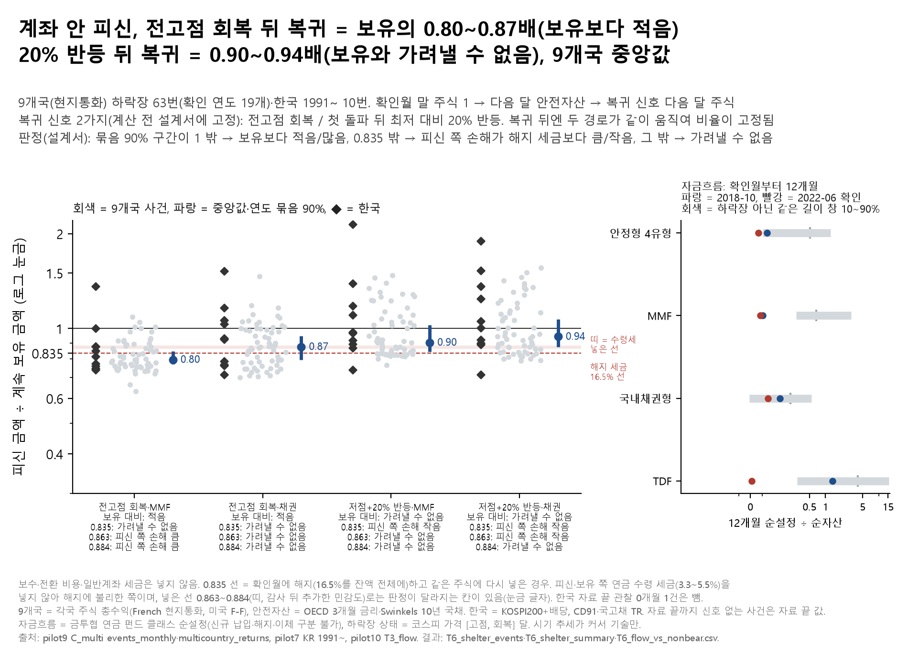

# 08. 하락장에 계좌 안에서 피신하기 — 해지 대신 MMF로 피했다 돌아오면 괜찮을까

## 문제의식

하락장에 "세금 16.5%를 내고 해지하느니, 연금계좌 안에서 MMF·채권형으로 옮겼다가 회복을 보고 돌아오면 된다"는 말이 있습니다. 세금은 없지만, 회복을 '확인'하고 돌아오는 사이에 주가가 이미 많이 올라 그 상승분을 놓칩니다. 놓친 상승분이 해지 세금보다 큰지 따져 봤습니다.

## 한 일

- 9개국(호주·캐나다·독일·프랑스·영국·일본·노르웨이·스웨덴·미국, 현지통화) 하락장 63번과 한국(1991~, KOSPI200+배당) 하락장 10번(자료 끝 2026-08 확인 1건은 관찰 0개월이라 값 없음)에서, 하락장 확인월 말 주식 1을 ① 계속 보유 ② 다음 달 안전자산(MMF 대용 단기금리, 또는 10년 국채·국고채)으로 옮겼다가 복귀 신호 다음 달 주식으로 돌아오는 경우를 비교했습니다.
- 복귀 신호는 계산 전에 설계서에 두 가지로 고정했습니다: (a) 그 하락장 고점 수준 회복, (b) 처음 −20%를 넘은 뒤의 최저점 대비 20% 반등. 둘 다 그 달 말까지의 자료만 씁니다. 사건 날짜는 10월 17일 C_multi 사건표와 같고(재현 확인), (a)·(b) 신호 달이 사건표의 회복월·재무장월 열과 같은지 확인했습니다.
- 지표 R = 피신 금액 ÷ 보유 금액. 돌아온 뒤에는 두 경로가 같이 움직이므로 R은 복귀 신호 달에 정해집니다. 9개국은 확인 연도로 묶어 다시 뽑는 부트스트랩(5,000회)으로 중앙값의 90% 구간을 냈습니다.
- 해지 비교선 0.835 = 확인월에 잔액 전체에서 16.5%를 떼고 같은 주식에 바로 다시 넣은 경우.
- **결과 뒤 확인한 설계서 전제 오류(감사 H1)**: 설계서는 이 선을 "해지에 유리한 쪽"이라고 적었지만 틀렸습니다. 피신·보유 쪽에 연금 수령 세금(3.3~5.5%)을 매기지 않았고 16.5%를 세액공제 받지 않은 원금까지 잔액 전체에 매겼으므로 해지에 **불리한** 쪽입니다(일반계좌 세금을 뺀 것만 해지에 유리). 그래서 설계서 판정(0.835 선)은 그대로 두고, 수령세를 넣은 손익분기 0.835 ÷ (1 − τ) = 0.863(τ 3.3%)·0.884(5.5%) 판정을 결과 뒤 민감도로 덧붙였습니다.
- 자금흐름: 금투협 연금 펀드 순설정(T3a판, TDF)으로 하락장 확인월(2018-10, 2022-06)부터 3·6·12개월 순설정 ÷ 순자산을, 하락장이 아닌 달로만 된 같은 길이 창들과 비교했습니다.
- 결과: `results/T6_shelter_events.csv`(사건별), `results/T6_shelter_summary.csv`(판정), `results/T6_flow_vs_nonbear.csv`, 그림 `fig_T6_계좌안피신`.

## 결과

- 저점 대비 20% 반등·MMF: 중앙 0.90배(90% 0.844~1.025; 신호 없음 3건을 빼면 0.832~1.035) → 보유 대비 가려낼 수 없음, 해지 대비(0.835 선, 설계서) 피신 비용 < 해지 세금, 수령세 넣은 선(0.863·0.884, 감사 뒤 민감도) 가려낼 수 없음·가려낼 수 없음. 사건 63개 중 보유보다 적었던 사건 39개, 0.835 아래 19개, 피신 기간 중앙 7개월, 보유보다 적었던 사건의 놓친 상승분(1/R − 1) 중앙 19%.
- 저점 대비 20% 반등·채권: 중앙 0.94배(90% 0.873~1.072; 신호 없음 3건을 빼면 0.871~1.086) → 보유 대비 가려낼 수 없음, 해지 대비(0.835 선, 설계서) 피신 비용 < 해지 세금, 수령세 넣은 선(0.863·0.884, 감사 뒤 민감도) 피신 비용 < 해지 세금·가려낼 수 없음. 사건 63개 중 보유보다 적었던 사건 37개, 0.835 아래 13개, 피신 기간 중앙 7개월, 보유보다 적었던 사건의 놓친 상승분(1/R − 1) 중앙 16%.
- 전고점 회복·MMF: 중앙 0.80배(90% 0.771~0.846; 신호 없음 3건을 빼면 0.769~0.839) → 보유 대비 피신이 적었다, 해지 대비(0.835 선, 설계서) 가려낼 수 없음, 수령세 넣은 선(0.863·0.884, 감사 뒤 민감도) 피신 비용 > 해지 세금·피신 비용 > 해지 세금. 사건 63개 중 보유보다 적었던 사건 58개, 0.835 아래 40개, 피신 기간 중앙 22개월, 보유보다 적었던 사건의 놓친 상승분(1/R − 1) 중앙 28%.
- 전고점 회복·채권: 중앙 0.87배(90% 0.794~0.947; 신호 없음 3건을 빼면 0.792~0.959) → 보유 대비 피신이 적었다, 해지 대비(0.835 선, 설계서) 가려낼 수 없음, 수령세 넣은 선(0.863·0.884, 감사 뒤 민감도) 가려낼 수 없음·가려낼 수 없음. 사건 63개 중 보유보다 적었던 사건 49개, 0.835 아래 24개, 피신 기간 중앙 22개월, 보유보다 적었던 사건의 놓친 상승분(1/R − 1) 중앙 19%.
- 한국 하락장(사건별, 묶음 구간 없음): 전고점 회복·MMF — 1992-05 확인 0.88배(11개월); 1995-02 확인 1.36배(57개월); 1998-04 확인 0.81배(9개월); 2000-02 확인 1.00배(59개월); 2001-09 확인 0.74배(2개월); 2002-09 확인 0.76배(16개월); 2008-07 확인 0.85배(28개월); 2011-09 확인 0.88배(66개월); 2018-12 확인 0.75배(23개월); 2022-06 확인 0.77배(36개월). 20% 반등·MMF — 1992-05 확인 0.97배(5개월); 1995-02 확인 2.14배(35개월); 1998-04 확인 1.10배(6개월); 2000-02 확인 1.39배(11개월); 2001-09 확인 0.74배(2개월); 2002-09 확인 0.97배(9개월); 2008-07 확인 1.18배(9개월); 2011-09 확인 0.89배(26개월); 2018-12 확인 0.87배(19개월); 2022-06 확인 0.92배(11개월).
- 확인 뒤 5년 시점으로 보면(5년 자료 있는 사건): 저점 대비 20% 반등·MMF 중앙 0.91배(90% 0.86~1.06, 54개); 저점 대비 20% 반등·채권 중앙 0.96배(90% 0.89~1.11, 54개); 전고점 회복·MMF 중앙 0.80배(90% 0.78~0.86, 54개); 전고점 회복·채권 중앙 0.89배(90% 0.83~0.98, 54개).
- 자금흐름(12개월): 안정형 4유형 순설정 ÷ 순자산은 2018-10 확인 뒤 0.142, 2022-06 확인 뒤 0.068였고, 하락장이 아닌 같은 길이 창(31개)은 중앙 0.512(10~90% 0.102~1.235). MMF는 0.103·0.084 대 중앙 0.675, TDF는 1.368·0.010 대 중앙 4.060(비교창 29개, 대부분 TDF 초기 2014~2017년).

## 말하면 안 되는 것

- "계좌 안 피신은 안전하다" / "피신하면 손해다" — 판정 칸이 '가려낼 수 없음'인 조합은 어느 쪽도 말할 수 없습니다. 사건마다 크게 갈립니다(회색 점).
- 사건 비율을 "확률"로 말하기 — 63개 사건은 같은 해 여러 나라가 겹친 사건이라 독립이 아닙니다.
- "하락장 뒤 연금 가입자가 MMF로 옮겼다" — 순설정은 신규 납입·해지·이체를 구분하지 못하고, 안정형→TDF 이동은 직접 보이지 않습니다. 시기 추세가 커서 '평소보다 많다/적다'로 쓰지 않습니다.

## 한계

- 0.835 선은 연금 수령 세금(3.3~5.5%)을 피신 쪽에 매기지 않았고 16.5%를 잔액 전체에 매겨 해지에 **불리한** 쪽입니다. 일반계좌 세금을 뺀 것만 해지에 유리합니다. 수령세를 넣은 선(0.863~0.884)으로 보면 판정이 바뀌는 칸이 있어(결과 줄의 '수령세 넣은 선'), 해지 대비 판정은 세금 가정에 민감합니다.
- 보수(MMF·채권형과 주식형 보수 차이)와 전환 비용(단기 환매수수료·ETF 호가)을 넣지 않았습니다. 방향은 정해지지 않습니다.
- 자금흐름 h = 3·6·12개월과 보조 지표 '확인 뒤 5년'은 설계 선택이고 근거 자료가 없습니다(판정에 쓰지 않음).
- 9개국은 세 계열(주식·단기금리·10년 국채)이 모두 있는 선진 생존 시장입니다.
- 9개국 안전자산은 단기금리·10년 국채 지수라 실제 연금 MMF·채권형 펀드와 다릅니다. 한국 채권은 국고채 TR입니다.
- 자료 끝까지 복귀 신호가 없는 사건은 자료 끝 값으로 넣었습니다(9개국 '신호없음' 열). 미국 2020-03 사건은 표본 끝(OECD 금리 공백)이라 피신 기간이 0입니다(R = 1, 설계서 판정 표본 63건에는 그대로 둠).
- 한국은 1991년 이후 10번뿐이라(자료 끝 2026-08 확인 1건은 관찰 0개월이라 R = 1로 고정되어 결과·그림에서 뺌, CSV에는 있음) 사건별 값만 보였습니다. 한국 사건은 KOSPI200 총수익 기준이라 10월 19일 C(코스피 가격, 3번)와 날짜가 다를 수 있습니다.
- 자금흐름 비교창은 겹치고, 하락장이 아닌 달이 2014~2017년에 몰려 있어 TDF처럼 빨리 커진 묶음은 비교가 어렵습니다.

## 그림

## 파일

- `figures/`: 그림(`.png`·`.svg`), 그림 숫자(`_data.csv`: 9개국 판정 요약, 한국 사건별 값, 자금흐름 12개월), 읽은 파일 sha256(`_source.txt`).
- `results/`: `T6_shelter_events.csv`(사건·복귀 규칙·안전자산별 R = 피신 ÷ 보유, 신호월, 피신 개월, 그 기간 주식·안전자산 누적 수익), `T6_shelter_summary.csv`(4칸 판정, 묶음 부트스트랩 구간, 수령세 민감도), `T6_flow_vs_nonbear.csv`(순설정 ÷ 순자산 비율과 비교 창 분위수). 모두 이 주제가 계산한 요약 값이고 월 수익률·지수·기준가·순설정 원값은 없습니다.
- `docs/설계서_포트폴리오_주제B_20261108.md`: 08~11 판정 규칙(원 연구 커밋 6ef8992에 계산 전 커밋된 원문 그대로). 원문의 드라이브 경로(`D:\…
esults\…`)는 원 연구 PC의 결과 폴더이고, 이 저장소에서는 각 주제 폴더의 `results/`·`figures/`입니다.
- 코드: `notebooks/portfolio/make_topics_b.py`(08~11 공용, 계산·그림·README). 하락장 날짜 규칙은 `../01_downturn_timing/notebooks/pilot9/_build_C_real_inputs.py`의 `dd_detail`, 한국 표본은 `../src/pension_lab/pilot7.py`의 `samples()`.
- 입력(이 저장소에 없음): French 국가별 주식(`fetch/pilot9_global_equity.py`), OECD 3개월 금리·Swinkels 10년 국채(`processed/multicountry_returns_20261017.csv`), 원 연구의 C_multi 사건표(`results/pilot9_20261013/C_multi_20261017/events_monthly.csv`, 재현 확인용), 국내 DataGuide 자료(KOSPI200 TR·국고채 TR·CD91), 금융투자협회 연금 펀드 순설정 묶음(`results/pilot10_20261017/T3_flow/`). 출처와 받는 법은 `../DATA_SOURCES.md`.
- 실행: 저장소 루트에서 `python 08_shelter_in_account/notebooks/portfolio/make_topics_b.py t6` — 원자료와 원 연구 결과 파일(위 '입력')이 `$PENSION_DATA_ROOT` 아래 원 연구와 같은 경로에 있어야 돕니다(`../DATA_SOURCES.md`). 이 저장소만으로는 돌지 않습니다.

본문의 'T2'·'T3'·'pilot7~10'·'C_multi'·'10월 19일 C·F'·'DOC_AUDIT'·'감사 H1·H2·H3·R1-H1' 같은 이름은 원 연구 저장소의 분석·감사 이름입니다(이 저장소에 없음). '감사'는 원 연구에서 결과를 낸 뒤 독립 감사자가 한 점검이고, '결과 뒤'라고 적은 규칙·구분은 결과를 본 뒤 추가한 것입니다. 판정 규칙의 원문은 설계서(계산 전 기록)입니다.

---
**English summary.** In a bear market, instead of cashing out a Korean pension account (16.5% tax), a saver could switch to a money-market or bond fund inside the account and return after a recovery signal. Across 63 confirmed bear markets in nine developed countries (local currency), returning only after the index regained its previous peak left the median saver with 0.80–0.87 times what holding would have given (90% cluster-bootstrap intervals below 1); returning after a 20% rebound from the low gave 0.90–0.94 times, not distinguishable from holding. Whether switching costs more than the cash-out tax depends on how later pension-income tax is treated: a sensitivity added after seeing the results changes some verdicts. Korean events since 1991 are reported one by one. Fund-flow data cannot separate new contributions from switches. Not investment advice.

_생성: 08_shelter_in_account/notebooks/portfolio/make_topics_b.py (본문 숫자는 결과 CSV에서 읽어 자동으로 채움. English summary는 고정 문장이고, 그 숫자는 `check_numbers.py`가 결과 CSV와 대조). 판정 규칙: `../08_shelter_in_account/docs/설계서_포트폴리오_주제B_20261108.md`(원 연구 커밋 6ef8992, 계산 전 기록)_
