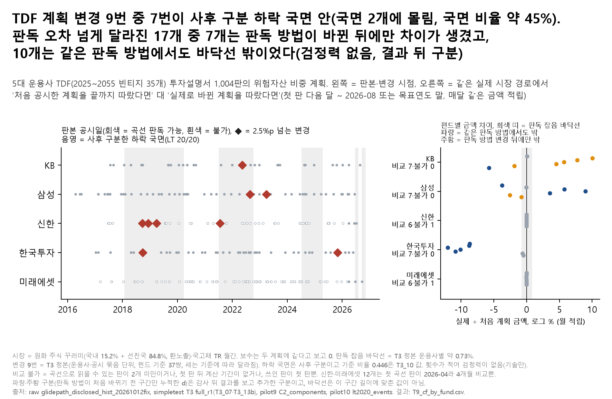

# 09. TDF 글라이드패스 변경 이력 — 계획이 바뀐 게 가입자 금액을 얼마나 바꿨나

## 문제의식

TDF는 "나이에 따라 주식 비중을 이렇게 줄이겠다"는 계획(글라이드패스)을 투자설명서에 공시합니다. 그런데 이 계획이 중간에 바뀐 적이 있습니다. 가입할 때 본 계획과 실제로 따른 계획이 달랐다면, 가입자 금액은 얼마나 달라졌을까요? 그리고 계획 변경이 하락장에 몰렸을까요?

## 한 일

- 5대 운용사(KB·삼성·신한·한국투자·미래에셋) TDF 35개(2025~2055 빈티지)의 투자설명서 1,004판에서 뽑은 위험자산 비중표(10월 27일 T3)를 그대로 썼습니다.
- 펀드마다 "처음 공시한 계획(곡선으로 읽을 수 있는 첫 판)을 끝까지 따른 경우"와 "실제로 바뀐 계획을 공시 시점마다 갈아탄 경우"를, 같은 실제 시장 경로(원화 주식 꾸러미·국고채 월 수익, 2016~2026)에서 첫 판 다음 달부터 2026-08(또는 목표연도 말)까지 매달 같은 금액을 넣어 비교했습니다. 판정 규칙은 계산 전에 설계서에 적었습니다.
- 차이가 T3에서 잰 판독 잡음 바닥선(같은 판을 두 번 읽을 때 생기는 차이의 95%, 약 0.73%) 안이면 "판독 오차와 구분 안 됨"으로 봤습니다.
- 변경 시점은 T3 정본의 9번(위험자산 비중 2.5%p 넘는 변경, 운용사·공시 묶음 단위)을 타임라인에 그렸습니다.
- 설계서 문구 정정(결과 보기 전): 설계서의 "그 달 말 이전에 접수된 판"을 "그 달 수익에는 전달 말까지 접수된 판"으로 구현했습니다(그 달 안에 공시된 계획을 그 달 초부터 쓰는 미래 정보 사용을 막기 위함).
- 결과: `results/T9_cf_by_fund.csv`(펀드별), 그림 `fig_T9_글라이드변경`.

## 결과

- **변경 9번 중 7번이 사후에 구분한 하락 국면 안이었습니다.** 이 국면은 전체 공시 기간의 약 45%(T3 기준 비율 0.446)입니다. 7번은 국면 2개에 몰려 있어 독립 사건 9개가 아니고, 국면 구분은 사후이며 후보 선택에 따라 달라집니다. 횟수가 적어 검정력이 없어 기술만 합니다(운용사별 KB 1, 삼성 2, 신한 4, 한국투자 2, 미래에셋 0).
- **처음 계획을 지켰을 때와 비교할 수 있는 펀드는 33개**였고(나머지 2개는 비교 불가), 이 중 의미 있는 기간(53~124개월)을 가진 것은 KB·삼성·한국투자 21개이고, 신한·미래에셋 12개는 첫 곡선 판이 2026-04라 4개월 비교뿐입니다(그래서 d ≈ 0).
- 금액 차이가 판독 잡음 바닥선보다 큰 펀드는 17개입니다. 감사(H2) 뒤 판독 방법이 처음 바뀌기 전 구간만 따로 누적해 보니(결과 뒤 추가한 구분): 8개(KB 2055, 삼성 2030, 삼성 2035, 삼성 2045, 한국투자 2030, 한국투자 2035, 한국투자 2040, 한국투자 2045)는 같은 방법 구간만으로도 바닥선 밖이고, 7개(KB 2030, KB 2035, KB 2040, KB 2045, KB 2050, 삼성 2050, 삼성 2055)는 차이가 방법 변경 뒤에만 생겨 계획 변경과 판독 방법 차이를 나눌 수 없으며, 2개(삼성 2025, 한국투자 2025)는 방법 변경을 건너지 않았습니다. 처음 보고서(b64ec7a)의 "17개 중 15개는 방법 변경과 나눌 수 없다"는 틀린 문장이었습니다(경로 어디서든 방법이 바뀐 판을 한 번이라도 쓰면 '나눌 수 없음'으로 셌음).
- KB: 비교 7개, 비교 불가 0개(첫 판 2017-07-24~2020-03-18, 계산 기간 77~109개월), 실제 ÷ 처음 계획 금액 로그 -5.72~+10.05%(중앙 +4.54%), 월 10만 원 적립 기준 금액 차이 -798,845~+1,719,496원, 바닥선 밖 6개, 판독 방법 변경을 건넌 펀드 7개.
- 미래에셋: 비교 6개, 비교 불가 1개(첫 판 2026-04-01~2026-04-01, 계산 기간 4~4개월), 실제 ÷ 처음 계획 금액 로그 -0.03~+0.02%(중앙 +0.00%), 월 10만 원 적립 기준 금액 차이 -121~+68원, 바닥선 밖 0개, 판독 방법 변경을 건넌 펀드 0개.
- 삼성: 비교 7개, 비교 불가 0개(첫 판 2016-04-18~2019-11-27, 계산 기간 81~124개월), 실제 ÷ 처음 계획 금액 로그 -3.73~+8.99%(중앙 -0.04%), 월 10만 원 적립 기준 금액 차이 -967,981~+1,842,909원, 바닥선 밖 6개, 판독 방법 변경을 건넌 펀드 6개.
- 신한: 비교 6개, 비교 불가 1개(첫 판 2026-04-01~2026-04-01, 계산 기간 4~4개월), 실제 ÷ 처음 계획 금액 로그 +0.00~+0.01%(중앙 +0.00%), 월 10만 원 적립 기준 금액 차이 +0~+29원, 바닥선 밖 0개, 판독 방법 변경을 건넌 펀드 1개.
- 한국투자: 비교 7개, 비교 불가 0개(첫 판 2017-01-13~2022-03-21, 계산 기간 53~115개월), 실제 ÷ 처음 계획 금액 로그 -12.01~-0.47%(중앙 -8.75%), 월 10만 원 적립 기준 금액 차이 -2,445,468~-38,256원, 바닥선 밖 5개, 판독 방법 변경을 건넌 펀드 6개.
- 가장 큰 차이: 한국투자 2030 (K55101BK7347), 2017-01-13~2026-08 115.0개월, 로그 -12.01%(월 10만 원 적립, 원금 11,500,000원 기준 -2,445,468원). 위험자산 비중 차이는 최대 20.1%p.

## 말하면 안 되는 것

- "운용사가 하락장을 예측해서 계획을 바꿨다" / "하락장에 몰렸다" — 9번뿐이고 국면은 사후 구분이라 검정력이 없습니다.
- "계획 변경으로 가입자가 손해(이득)를 봤다" — 판독 오차보다 큰 차이는 일부 펀드뿐이고, 일부는 방법 변경 뒤에만 차이가 생겨 방법 차이와 분리되지 않으며, 바닥선은 체계적 판독 차이를 담지 못합니다. 지수 × 비중 근사이지 실제 펀드 수익이 아닙니다.
- "하락 국면 안에 몰렸다" — 국면 안의 변경은 국면 몇 개 안에 묶여 있어 독립 사건이 아닙니다.
- 정확 이항 p 값을 근거로 쓰기(T3 SAY_OK 금지 목록).

## 한계

- 실제 펀드가 아니라 '공시 위험자산 비중 × 지수' 근사입니다. 위험자산 안의 구성(국내·해외, 환헤지) 변화는 반영하지 않았고, 보수는 두 계획에 같다고 보고 0으로 뒀습니다.
- 오래된 빈티지의 첫 판은 그 시점 이후 구간만 공시해 범위 밖은 끝값으로 고정했습니다(`범위밖비율` 열).
- 신한은 2026-04 이전 판 대부분이 0년 지점·그래프 왼쪽 끝만 읽혀 곡선을 만들 수 없고, 미래에셋은 2026-04 이전 판에 그래프가 없습니다. 그래서 두 운용사는 첫 곡선 판이 2026-04이고 비교가 4개월뿐입니다. 신한의 2018~2021년 변경 4번은 금액 계산에 들어가지 못했습니다.
- 바닥선은 T3의 2055·양식화 경로 조건에서 같은 판독 방법 안의 무작위 오차로 만든 값입니다. 지평이 다른 이 계산과, 같은 방법 안의 체계적 판독 차이·방법 변경의 체계적 차이에는 그대로 맞지 않습니다. 그래서 '같은 방법 구간에서도 바닥선 밖'도 "계획 변경 효과"라고 단정하지 않습니다.
- 설계서 문구("그 달 말 이전 접수") 그대로 구현했다면 바닥선 밖이 1개 늘어 18개였습니다(감사 L1; 구현은 미래 정보가 없는 '전달 말까지' 쪽). 이 정정은 결과와 같은 커밋(9761f8b)에 들어가 git으로 '결과 전'을 확인할 수는 없습니다.
- 변경 9번은 T3 정본의 운용사·공시 묶음 단위이고, 펀드 기준으로는 37쌍이라 세는 기준에 따라 달라집니다(DOC_AUDIT 9절).
- 5대 운용사의 현존 펀드만 봤고 청산·합병 TDF는 없습니다.
- 한 번뿐인 실제 시장 경로라 다른 시장에서는 크기·부호가 달라질 수 있습니다. 10월 27일 T3의 반사실(모든 빈티지를 2001년 30세로 놓은 양식화 계산, T3_14)과는 기간 정의가 다릅니다.
- 미국 선행연구(Brown·Davies·Sobotka)는 제목만 확인했고 원문 대조는 하지 않았습니다.

## 그림

## 파일

- `figures/`: 그림(`.png`·`.svg`), 그림 숫자(`_data.csv`: 운용사 요약과 변경 9번 날짜), 읽은 파일 sha256(`_source.txt`). 왼쪽 판본 점은 투자설명서 공시일이고, 공시 위험자산 비중 값은 그림·표 어디에도 넣지 않았습니다.
- `results/`: `T9_cf_by_fund.csv`(펀드별 첫 판·계산 기간·쓰인 판 수·판독 방법 변경·d·월 10만 원 금액 차이·판정·원인 구분). 원 연구의 평균 위험비중 2열과 펀드·월별 비중표(`T9_cf_weights_monthly.csv`)는 공시 글라이드 값이라 넣지 않았습니다.
- 판정 규칙: `../08_shelter_in_account/docs/설계서_포트폴리오_주제B_20261108.md` 9번.
- 코드: `../08_shelter_in_account/notebooks/portfolio/make_topics_b.py`(08~11 공용).
- 입력(이 저장소에 없음): 공시 글라이드 판본표(`raw/fund_tdf/glidepath_disclosed_hist_20261012fix.csv`, 금융투자협회 전자공시 투자설명서에서 읽음), 원 연구 T3 결과(`results/simpletest_20261027/T3/full_r1_20261027_0433/`의 변경 사건·판독 잡음 바닥선), 시장 경로(`results/pilot9_20261013/C_real_20261017/inputs/C2_components_monthly.csv`, DataGuide 가공), 하락 국면(`results/pilot10_20261017/I2x_hist/results_lt2020/lt2020_events.csv`). 출처는 `../DATA_SOURCES.md`.
- 실행: 저장소 루트에서 `python 08_shelter_in_account/notebooks/portfolio/make_topics_b.py t9` — 원자료와 원 연구 결과 파일(위 '입력')이 `$PENSION_DATA_ROOT` 아래 원 연구와 같은 경로에 있어야 돕니다(`../DATA_SOURCES.md`). 이 저장소만으로는 돌지 않습니다.

본문의 'T2'·'T3'·'pilot7~10'·'C_multi'·'10월 19일 C·F'·'DOC_AUDIT'·'감사 H1·H2·H3·R1-H1' 같은 이름은 원 연구 저장소의 분석·감사 이름입니다(이 저장소에 없음). '감사'는 원 연구에서 결과를 낸 뒤 독립 감사자가 한 점검이고, '결과 뒤'라고 적은 규칙·구분은 결과를 본 뒤 추가한 것입니다. 판정 규칙의 원문은 설계서(계산 전 기록)입니다.

---
**English summary.** Korean target-date funds have revised the glide paths disclosed in their prospectuses. Comparing, on the same realized market path with equal monthly contributions, the plan first disclosed with the plan actually in force, the difference exceeded a chart-reading error floor for 17 of 33 comparable funds (the largest about −12% in log terms over 115 months); 12 of the 33 had only four months to compare. For 7 of the 17 the difference appeared only after the way the prospectus chart was read changed, so plan changes and reading method cannot be separated there. Seven of nine plan changes fell inside downturn phases identified after the fact, but they cluster in two phases and the count is too small to test. Not investment advice.

_생성: 08_shelter_in_account/notebooks/portfolio/make_topics_b.py (본문 숫자는 결과 CSV에서 읽어 자동으로 채움. English summary는 고정 문장이고, 그 숫자는 `check_numbers.py`가 결과 CSV와 대조). 판정 규칙: `../08_shelter_in_account/docs/설계서_포트폴리오_주제B_20261108.md`(원 연구 커밋 6ef8992, 계산 전 기록)_
