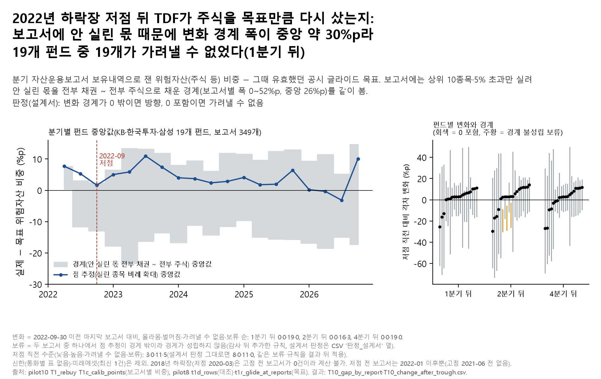

# 10. TDF는 하락장 뒤 주식을 다시 사 주나 — 분기 보고서로 직접 재 보기

## 문제의식

TDF는 나이에 맞춰 정한 주식 비중(목표)을 유지해야 합니다. 하락장에 주가가 떨어지면 주식 비중이 저절로 낮아지므로, 계획대로라면 바닥 뒤 주식을 다시 사서 목표로 돌아와야 합니다. 10월 19일 F에서는 일별 기준가로 비중을 추정했는데 그 방법이 한쪽으로 치우쳐, 이번에는 분기 자산운용보고서의 실제 보유내역으로 직접 쟀습니다.

## 한 일

- 이미 모은 분기 자산운용보고서 보유내역에서 pilot10 T1c가 보고서마다 계산한 위험자산 비중을 썼습니다(KB·한국투자·삼성 19개 펀드, 보고서 349개, 2022-01-20~2026-08-10). pilot8에서 같은 보고서로 잰 값과 같은지 확인했습니다.
- 보고서에는 상위 10종목과 5% 넘는 종목만 실립니다. 안 실린 몫을 전부 채권으로 본 값(하한)과 전부 주식으로 본 값(상한)을 경계로, 실린 종목을 비례로 늘린 값을 점으로 봤습니다. 경계 폭은 보고서별 0~52%p(중앙 26%p)입니다.
- 목표 = 그 보고서 날짜에 유효했던 투자설명서 글라이드(민감도: 2026년 공시).
- 판정 규칙(계산 전 설계서): 2022-09 저점 이전 마지막 보고서 대비 1·2·4번째 뒤 보고서의 '실제 − 목표' 변화가 경계째 0 위면 "목표 쪽으로 다시 올라옴", 0 아래면 "더 벌어짐", 0을 포함하면 "가려낼 수 없음".
- **결과 뒤 추가한 규칙(감사 H3)**: 기준·뒤 보고서 중 하나라도 점 추정이 경계 밖이면 그 보고서의 경계가 성립하지 않으므로, 방향 판정을 "판정 보류(경계 불성립)"로 바꿨습니다. 재감사(R1-H1)에서 이 규칙을 저점 뒤 변화에만 쓰고 저점 직전 수준(낮음/높음)에는 쓰지 않은 비대칭을 지적받아, 같은 규칙을 저점 직전 수준에도 적용했습니다. 설계서 판정은 `T10_change_after_trough.csv`의 `판정_설계서`·`기준판정` 열에 그대로 남겼습니다.
- 결과: `T10_gap_by_report.csv`, `T10_change_after_trough.csv`, 그림 `fig_T10_TDF재매수`.

## 결과

- **할 수 있었던 사건은 2022년 하락장(고점 2021-06, 저점 2022-09) 하나**였습니다. 2018년 하락장(저점 2020-03)은 고점 전 보고서가 한 건도 없어 계산하지 못했습니다.
- **저점 직전 '실제 − 목표'**(그때 유효 목표): 19개 펀드 중 목표보다 낮음 3개, 높음 0개, 가려낼 수 없음 11개, 판정 보류(경계 불성립) 5개. 설계서 규칙 그대로면 낮음 8·높음 0·가려낼 수 없음 11개입니다(CSV `기준판정` 열). 보류 5개(KB 2045, KB 2055, 한국투자 2040, 한국투자 2045, 한국투자 2050)는 기준 보고서에서 점 추정이 경계 밖이라 경계가 성립하지 않고, 점 추정 격차는 -0.02~+1.79%p입니다(재감사 R1-H1 뒤 같은 규칙을 기준 수준에도 적용, 결과 뒤 변경).
- 목표를 2026년 공시로 바꾸면 저점 직전: 낮음 2·높음 1·가려낼 수 없음 15·보류 1개.
- **저점 뒤 변화**(그때 유효 목표, 올라옴·벌어짐·가려낼 수 없음·판정 보류 순): 1분기 뒤 0·0·19·0개, 2분기 뒤 0·0·16·3개, 4분기 뒤 0·0·19·0개. 방향(올라옴·벌어짐)이 나온 칸은 0개입니다.
- 판정 보류 3개는 한국투자 2022-09-01~2023-03-01 비교입니다(k = 2). 설계서 규칙으로는 '더 벌어짐' 판정이었지만, 점 추정이 경계 밖으로 16~25%p 나가 경계가 성립하지 않았고, 같은 비교의 점 추정 변화는 +2.7~+3.1%p였습니다. 방향으로 읽지 않습니다.
- 목표를 2026년 공시로 바꾸면: 1분기 뒤 0·0·19·0개, 2분기 뒤 0·0·16·3개, 4분기 뒤 0·0·19·0개(같은 순서).
- 변화 경계 폭(1분기 뒤)은 중앙 30%p라 '가려낼 수 없음'은 TDF 행동에 대한 정보라기보다 측정 방법(안 실린 몫)의 한계에서 거의 구조적으로 나옵니다.
- 점 추정 중앙값(분기별)은 -3.1~+11.0%p 사이였습니다.

## 말하면 안 되는 것

- "TDF는 하락장 뒤 주식을 다시 사지 않는다" / "제대로 되산다" — 경계가 0을 포함한 칸은 어느 쪽도 말할 수 없습니다.
- 점 추정(비례 확대)만 보고 판단하기 — 안 실린 몫이 크고, 점 추정은 그 몫이 실린 종목과 같은 비율이라는 가정입니다.

## 한계

- 보고서에 안 실린 몫이 커서 경계가 넓습니다. 이것이 결과를 '가려낼 수 없음' 쪽으로 미는 가장 큰 이유입니다.
- 점 추정(실린 종목 비례 확대)은 경계 안에 있다는 보장이 없습니다(경계는 원화 현금 몫을 늘 안전자산으로 두기 때문). 보고서 349개 중 96개에서 점이 경계 밖이었습니다. 그런 보고서가 들어간 방향 판정(저점 뒤 변화와 저점 직전 수준 모두)은 결과 뒤 규칙으로 보류했습니다(위). 저점 직전 기준 보고서 중 점이 경계 밖인 것은 7개입니다.
- pilot8의 같은 보고서 값과 대조했을 때 2025년 이후 보고서 13행이 달랐습니다(KB 1행, 한국투자 12행, `T10_pilot8_mismatch.csv`, 원인 미확인). 그래서 설계서의 "같은지 assert"를 "2024년까지 같은지"로 완화했습니다(결과 뒤 변경). 판정 창(2022~2023년)에는 영향이 없고, 그림의 2025~2026년 분기 값에는 들어 있습니다.
- KB·한국투자·삼성만 들어갔습니다. 신한은 통화별 표가 없어 같은 방식으로 나눌 수 없고, 미래에셋은 최신 보고서 1건뿐입니다. 한국투자 2022-03 보고서는 암호화로 받지 못했습니다.
- 사건이 하나뿐이고, 저점 전 보고서는 2022-01 이후만 있어 고점(2021-06) 무렵 비중은 보지 못했습니다. 2021년 보고서 일부(KB 6·한국투자 1·삼성 1 펀드, 다른 폴더)와 2026년 하락 뒤 새 보고서는 아직 파싱하지 않았습니다.
- 위험자산 = 투자설명서 정의(주식·금 등). 목표 글라이드는 그래프 판독 값입니다.
- 현존 펀드만 봤고 청산·합병 TDF는 없습니다.

## 그림

## 파일

- `figures/`: 그림(`.png`·`.svg`), 그림 숫자(`_data.csv`: 분기 중앙값과 판정 개수), 읽은 파일 sha256(`_source.txt`).
- `results/`: `T10_gap_by_report.csv`(보고서별 '실제 − 목표' 격차의 점·하한·상한과 점이 경계 밖인지), `T10_change_after_trough.csv`(펀드별 저점 직전 수준과 1·2·4번째 뒤 보고서 변화, 설계서 판정과 결과 뒤 보류 규칙 판정), `T10_pilot8_mismatch.csv`(원 연구 두 계산의 값 차이). 보유내역 원행·비중 값·공시 목표 값은 넣지 않았고 격차만 넣었습니다(비중과 격차를 함께 두면 공시 글라이드 값이 되살아나므로).
- 판정 규칙: `../08_shelter_in_account/docs/설계서_포트폴리오_주제B_20261108.md` 10번.
- 코드: `../08_shelter_in_account/notebooks/portfolio/make_topics_b.py`(08~11 공용). 자산운용보고서 받는 코드는 `../src/pension_lab/fetch/mgmt_report_tdf.py`.
- 입력(이 저장소에 없음): 원 연구가 보유내역에서 만든 보고서별 위험자산 비중(`results/pilot10_20261017/T1_rebuy/T1c_calib_points.csv`, 대조용 `results/pilot8_20261010/T1d_desc/t1d_rows.csv`)과 보고서 날짜의 공시 목표(`results/pilot8_20261010/T1_reduced/t1r_glide_at_reports.csv`). 출처는 `../DATA_SOURCES.md`.
- 실행: 저장소 루트에서 `python 08_shelter_in_account/notebooks/portfolio/make_topics_b.py t10` — 원자료와 원 연구 결과 파일(위 '입력')이 `$PENSION_DATA_ROOT` 아래 원 연구와 같은 경로에 있어야 돕니다(`../DATA_SOURCES.md`). 이 저장소만으로는 돌지 않습니다.

본문의 'T2'·'T3'·'pilot7~10'·'C_multi'·'10월 19일 C·F'·'DOC_AUDIT'·'감사 H1·H2·H3·R1-H1' 같은 이름은 원 연구 저장소의 분석·감사 이름입니다(이 저장소에 없음). '감사'는 원 연구에서 결과를 낸 뒤 독립 감사자가 한 점검이고, '결과 뒤'라고 적은 규칙·구분은 결과를 본 뒤 추가한 것입니다. 판정 규칙의 원문은 설계서(계산 전 기록)입니다.

---
**English summary.** Did Korean target-date funds buy equities back toward their glide-path targets after the 2022 bear-market low? Quarterly holdings reports (three managers, 19 funds, 349 reports) list only the largest holdings, so the risky-asset share can only be bounded. The bound on the change is about 30 percentage points wide (median), and none of the 19 funds showed a distinguishable direction (the bounds included zero) one, two or four quarters after the low. Two quarters after, the rule written before the calculation would have called 3 funds 'gap widened'; these were held back under a rule added after seeing the results, because the point estimate lay outside its own bounds. This reflects the limits of the measurement more than fund behaviour. Not investment advice.

_생성: 08_shelter_in_account/notebooks/portfolio/make_topics_b.py (숫자는 결과 CSV에서 읽어 자동으로 채움). 판정 규칙: `../08_shelter_in_account/docs/설계서_포트폴리오_주제B_20261108.md`(원 연구 커밋 6ef8992, 계산 전 기록)_
