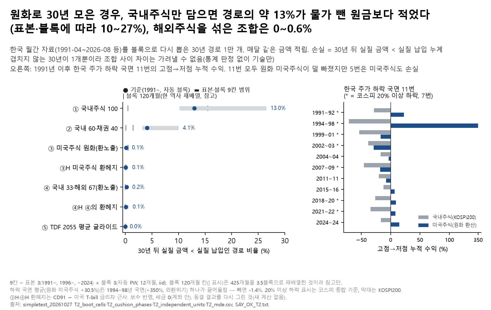

# 11. 원화로 저축하는 30세에게 "30년이면 주식은 안전하다"가 맞나

## 문제의식

"30년 묻어 두면 주식은 손해 보지 않는다"는 말은 주로 미국 자료에서 나왔습니다. 원화로 벌고 원화로 은퇴하는 한국 저축자에게도 맞을까요? 또 1997년·2008년처럼 한국 주가가 떨어질 때 원화 가치도 함께 떨어진 적이 있어, 환율 위험을 막지 않은 해외주식이 원화로는 손실을 덜어 줬을 수 있습니다.

## 한 일

- 10월 27일 T2에서 이미 계산하고 감사(3회)를 거친 결과를 그림 1장과 이 요약으로 정리했습니다. 새 계산은 없습니다.
- 한국 월간 자료(1991-04~2026-08, 425개월)를 블록 부트스트랩으로 다시 뽑아 30년 적립 경로 1만 개를 만들고, 일곱 조합의 '30년 뒤 물가 뺀 금액이 물가 뺀 납입 누계보다 적은 경로 비율'을 셌습니다.
- 표본(1991~, 1996~, 2024년까지)과 블록 길이(자동 추정, 12개월, 1개월=iid, 120개월)를 바꿔 같은 계산을 했습니다.
- 1991년 이후 한국 주가 하락 국면 11번에서 국내주식과 원화로 환산한 미국주식의 고점→저점 누적 수익을 비교했습니다.
- 다국가(한국 1980~ 코스피, French 21개국+미국, OECD 17개국)로도 이미 계산했지만, 원화 조합 비교는 한국 자료로만 할 수 있어 이 그림에는 넣지 않았습니다.

## 결과

- **국내주식만 담으면 경로의 약 13%(0.1296)가 30년 뒤 물가 뺀 원금보다 적었습니다**(1991~, 자동 블록). 표본·블록에 따라 10.2~26.5%, 블록 120개월 칸까지 넣으면 0.5~26.5%입니다(2025~26년 급등을 뺀 2024년까지 표본에서 가장 높음).
- 다른 조합(기준 칸): 국내 60·채권 40 4.07%, 미국주식 원화 0.11%, 국내 33·해외 67 0.21%, TDF 2055 평균 글라이드 0.00%(0/10,000, 다시 뽑기 오차 상한 약 0.03%).
- **조합 사이 차이는 가려낼 수 없었습니다.** 겹치지 않는 30년 기간이 1개뿐이라(실효 독립 단위 1), ③−①·④−①을 가려내려면 손실 비율 차이가 약 0.52·0.49는 되어야 했습니다(국내주식만의 비율 자체보다 큼).
- **하락 국면 11번(20% 이상 하락 7번) 모두 원화 미국주식이 국내주식보다 덜 빠졌지만, 11번 중 5번은 미국주식도 원화로 손실이었습니다.** 원화 미국주식 평균 +30.5%는 1994~98년 국면(외환위기, +350%) 하나가 끌어올린 것이고, 그 국면을 빼면 -1.4%입니다.

## 말하면 안 되는 것

- "30년이면 주식은 안전하다/위험하다", "장기라 안전" — 실효 독립 단위가 1이라 이 자료로는 말할 수 없습니다.
- "약 13% 손해" — 손실 크기가 아니라 '원금보다 적은 경로의 비율'이고, 확률이 아니라 다시 뽑은 경로 중 비율입니다.
- "해외주식 쿠션이 하락장마다 작동했다", "하락장 평균 +30%" — 1997년 한 번이 평균을 좌우했고, 5번은 미국주식도 손실이었습니다.
- "환헤지가 유리하다" — 헤지는 금리차로 근사한 값입니다. "22개국 자료"라고 쓰지 않습니다(French 21개국+미국).

## 한계

- 겹치지 않는 30년 기간이 사실상 1개라 조합 사이 차이를 통계로 가려낼 수 없습니다(기술만).
- 국내주식은 KOSPI200+배당(2011년 이전 배당은 배당수익률로 근사), 미국주식은 S&P500을 원화로 환산했습니다. 환헤지는 CD91 − 미국 T-bill 금리차 근사입니다.
- 가장 가까운 해외 연구 Anarkulova·Cederburg·O'Doherty(2022, 저자 최종원고)는 선진국 39개국을 나라별 자국 통화 실질 기준으로 봤고 한국 1996~2019도 포함합니다. 같은 저자들의 2022년 11월 논문은 자국 통화 기준 해외주식도 다룹니다. 이 정리의 차별점은 '원화 저축자의 환노출 해외주식 조합'에 한정되며, 정의·표본이 달라 ACO 숫자와 직접 비교하지 않습니다.
- 하락 국면 20% 이상 표시는 코스피 종합 기준이고 막대는 KOSPI200이라 2011년 국면처럼 어긋나는 곳이 있습니다.
- 이 저장소에서는 원 계산(1만 경로 재추출)을 다시 돌릴 수 없습니다. 원자료(DataGuide 등)와 판정 단계 파일이 없어, `results/simpletest_T2/`의 동결 결과만 읽습니다.

## 그림

## 파일

- `figures/`: 그림(`.png`·`.svg`), 그림 숫자(`_data.csv`), 읽은 파일 sha256(`_source.txt`).
- `results/simpletest_T2/`: 원 연구 T2의 동결 결과 중 이 그림·요약이 읽는 것 — `T2_boot_cells.csv`(표본·블록·조합별 30년 손실 경로 비율 등 1만 경로 요약), `T2_cushion_phases.csv`(하락 국면별 국내주식·원화 미국주식 누적 수익), `T2_independent_units.csv`(겹치지 않는 30년 창·실효 독립 단위), `T2_mde.csv`(구별 가능 최소 차이), `SAY_OK_T2.txt`(원 연구 감사 뒤 쓸 수 있는 문장 범위).
- 코드: `../08_shelter_in_account/notebooks/portfolio/make_topics_b.py`(그림·README), `notebooks/simpletest/`(원 계산: `_gen_T2.py`가 `T2_30년주식안전성.py`를 노트북으로 만들어 실행, 공통 함수 `_t2_core.py`; 판정 단계 `T2_판정r2.py`·`T2_판정r3.py`·`T2_판정r3b.py`도 쓰는데 이 저장소에 없음). 원 계산은 원 연구 폴더 구조와 DataGuide 원자료, 위 판정 단계 파일이 필요해 그대로는 돌지 않습니다(`../DATA_SOURCES.md` 3절, 쓰는 곳 '11(원 T2 계산)'). 코드 주석·상수표의 '회원 지정'은 연구 의뢰인(작성자)이 정한 값이라는 뜻입니다. `_t2_core.py` 자가점검의 `0.7844`는 5대 운용사 2055 공시 글라이드 평균의 30년 전 값 하나입니다(운용사별 값 아님).
- 실행: 저장소 루트에서 `python 08_shelter_in_account/notebooks/portfolio/make_topics_b.py t12` — 저장소 `results/simpletest_T2/`만 읽어 원자료 없이 됩니다.

본문의 'T2'·'T3'·'pilot7~10'·'C_multi'·'10월 19일 C·F'·'DOC_AUDIT'·'감사 H1·H2·H3·R1-H1' 같은 이름은 원 연구 저장소의 분석·감사 이름입니다(이 저장소에 없음). '감사'는 원 연구에서 결과를 낸 뒤 독립 감사자가 한 점검이고, '결과 뒤'라고 적은 규칙·구분은 결과를 본 뒤 추가한 것입니다. 판정 규칙의 원문은 설계서(계산 전 기록)입니다.

---
**English summary.** Is "stocks are safe over 30 years" true for a saver who earns and retires in Korean won? Resampling Korean monthly data (1991–2026) into 10,000 thirty-year contribution paths, about 13% of paths holding only Korean equities ended below inflation-adjusted contributions (10.2–26.5% across three samples and three block settings (automatic, 12-month and 1-month), excluding a 120-month block); mixes with unhedged foreign equities were at 0–0.5%. With only one non-overlapping 30-year period, differences between mixes cannot be distinguished statistically. In all 11 Korean downturns since 1991, US equities in won fell less than Korean equities, but in 5 of them they also lost money in won. Not investment advice.

_생성: 08_shelter_in_account/notebooks/portfolio/make_topics_b.py (본문 숫자는 결과 CSV에서 읽어 자동으로 채움. English summary는 고정 문장이고, 그 숫자는 `check_numbers.py`가 결과 CSV와 대조). 판정 규칙: `../08_shelter_in_account/docs/설계서_포트폴리오_주제B_20261108.md`(원 연구 커밋 6ef8992, 계산 전 기록)_
